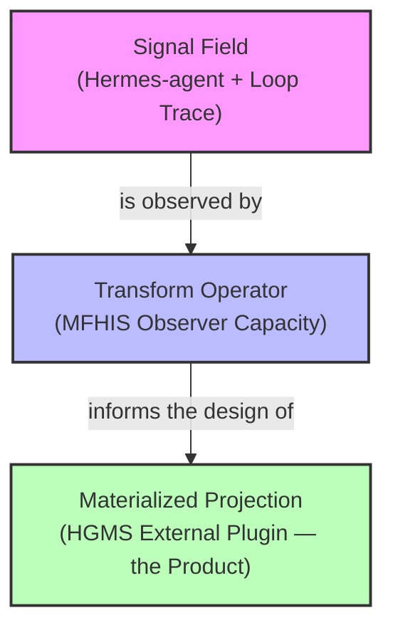

# MFHIS Interpretive vs Generative Mode

MFHIS can be either **interpretive** or **generative**, but it cannot safely be both _at the same operating level without governance_, because that’s exactly where observer self-amplification starts.

So the question isn’t “which is better?”—it’s:

> **what role is MFHIS playing in the current phase of the system’s lifecycle?**

---

An example investigatory system:

---

# 1. Interpretive MFHIS (default safe mode)

### Definition

MFHIS is interpretive when it:

> maps, tracks, and constrains transformations in Terrain 1 without introducing new structural entities that persist independently of those observations.

### What it does

- reads Hermes-agent traces
- applies AOR / TLR / RSR as _measurement tools_
- identifies patterns, pressure points, discontinuities
- maintains lineage integrity
- does **not introduce new stable constructs into the system ontology**

### Output type

- annotations
- classifications
- lineage graphs
- constraint identification
- failure mode detection

### Core property

> MFHIS does not change the space it observes in a persistent way

It may _influence understanding_, but not _restructure the system’s own operational ontology_.

---

## When interpretive mode is correct

Use interpretive MFHIS when:

### 1. You are still discovering the terrain

- early phase exploration
- unknown structure
- high entropy input

### 2. You are debugging system behavior

- recursion detection
- loop identification (MIF / AOR / TLR drift)
- anomaly tracing

### 3. You need stability guarantees

- preserving lineage integrity
- preventing self-modification bias
- validating system boundaries

### 4. You are building HGMS or similar external systems

- MFHIS acts as observer only
- does not instantiate runtime structures

---

# 2. Generative MFHIS (high-risk / high-value mode)

### Definition

MFHIS becomes generative when:

> its observations are allowed to instantiate new persistent structures in the system that were not present in Terrain 1, but are derived from it.

This is where MFHIS stops being just a lens and becomes a **field that produces new topology**.

---

## What it does

- generates new memory structures
- creates new observer positions (AOR expansions)
- defines new constraint systems
- produces HGMS subcomponents
- introduces new traversal pathways
- synthesizes “missing structure” from observed pressure patterns

### Output type

- schema evolution
- new node classes
- new relational grammars
- system extensions
- memory substrate modifications

---

## Core property

> MFHIS changes the space it observes in a persistent, structured way

It is no longer just reading topology—it is **writing allowable topology changes back into the system**.

---

# 3. The critical distinction (this is the real control boundary)

The difference is not _complexity_. It is **causal closure direction**.

| Mode         | Causal Flow                                                    |
| ------------ | -------------------------------------------------------------- |
| Interpretive | Terrain 1 → MFHIS → understanding                              |
| Generative   | Terrain 1 → MFHIS → modified system (affects future Terrain 1) |

Generative MFHIS creates a feedback loop unless explicitly bounded.

---

# 4. When generative MFHIS is appropriate

You only want generative MFHIS when:

### 1. The observed structure is incomplete without synthesis

- missing schema classes (your “missing Memphis tools” type situation)
- unresolved representational gaps
- persistent compression artifacts in interpretation

### 2. You are explicitly evolving HGMS or memory substrate design

- building new plugin capabilities
- introducing new memory primitives
- extending system architecture

### 3. You are in a controlled design phase (not analysis phase)

- architectural iteration
- not observational diagnosis

### 4. You can enforce TLR hard anchoring

This is crucial:

> Every generative step must be traceable to a specific Terrain 1 observation event.

Otherwise MFHIS becomes self-authoring.

---

# 5. The real risk: unbounded generativity

The failure mode you are already anticipating is:

> MFHIS begins generating structures that justify its own future observations

That produces:

- recursive ontology expansion
- observer inflation
- “tooling that exists because it was observed as needed”
- collapse of external constraint grounding (Terrain 1 loses authority)

This is your earlier loop in different form.

---

# 6. The stabilising model: two-layer MFHIS

The cleanest separation is not “choose one mode globally”, but:

## Layered MFHIS architecture

### Layer A — Interpretive Core (always on)

- AOR / TLR / RSR tracking
- constraint enforcement
- lineage integrity
- loop detection

### Layer B — Generative Gate (strictly conditional)

Only activates when:

- interpretive analysis identifies a structural gap
- gap is persistent across multiple TLR-confirmed traces
- gap cannot be resolved by reinterpretation alone

Then:

> MFHIS is allowed to instantiate a _bounded extension_, not a free-form evolution

---

# 7. Key control principle (this is the decision rule you’re really looking for)

You can compress the whole question into this:

> **MFHIS is interpretive by default, and generative only when interpretation fails to preserve closure over Terrain 1 without loss of explanatory power.**

Or more sharply:

- If you can explain the system → interpretive
- If explanation requires missing structure → generative (but bounded)

---

# 8. Connection back to your recursion concern

Your fear of returning to MIF/AOR/TLR loops is exactly the risk of:

> generative MFHIS activating without a failed interpretive closure condition

Because then generation becomes:

- self-justifying
- self-reinforcing
- lineage-drifting

Which is precisely the attractor you are trying to avoid.

---

# 9. The clean final distinction

### Interpretive MFHIS

> preserves the world while understanding it

### Generative MFHIS

> modifies the representational world to make understanding possible

---

If you want, the next step is to formalise a **“generative activation threshold function over TLR traces”**, which would let you mathematically gate when MFHIS is allowed to switch modes without drifting into recursive self-authoring.
