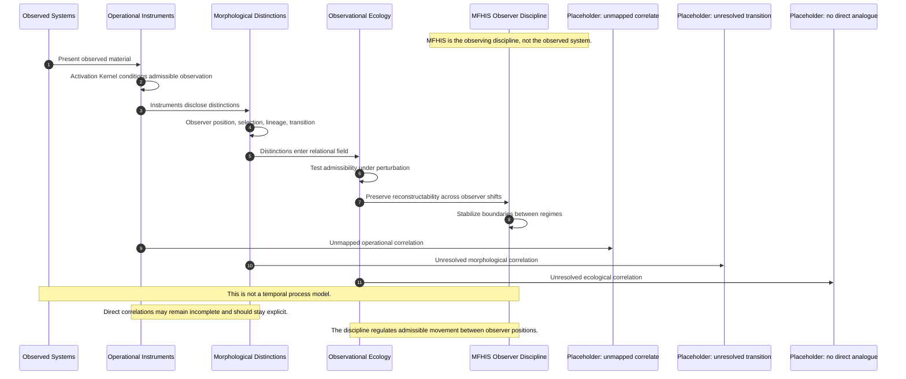
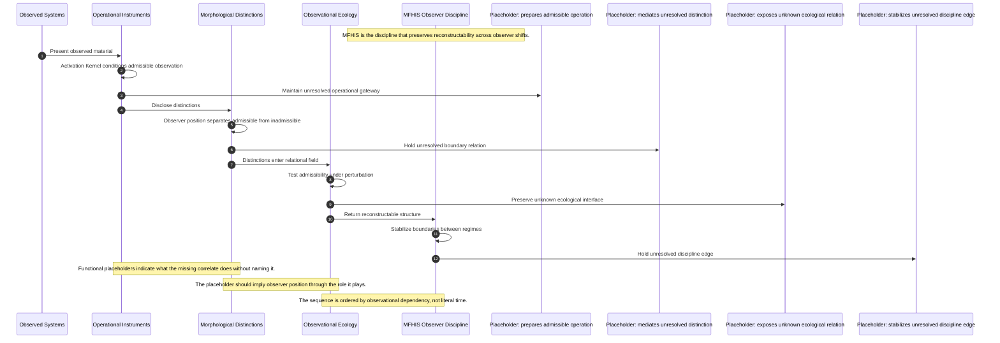

# MFHIS Diagrams

## 1) MFHIS flowchart equivalent

```mermaid
flowchart TD
    %% Styles
    classDef observed fill:#f9fbff,stroke:#2b4c7e,stroke-width:2px;
    classDef operative fill:#eef8f1,stroke:#2f7d32,stroke-width:2px;
    classDef morphological fill:#fff8e8,stroke:#b36b00,stroke-width:2px;
    classDef ecological fill:#f4efff,stroke:#6b4ca5,stroke-width:2px;
    classDef discipline fill:#f0f0f0,stroke:#444,stroke-width:2px,stroke-dasharray: 4 4;
    classDef placeholder fill:#ffffff,stroke:#999,stroke-width:2px,stroke-dasharray: 6 4,color:#666;

    %% Observed System / Inputs
    A[Observed Systems]:::observed
    A1[MFHIS-relevant observed system]:::observed
    A2[Placeholder: non-correlated observed domain]:::placeholder

    %% Operational Instruments
    B[Operational Instruments]:::operative
    B1[Activation Kernel]:::operative
    B2[Chronos]:::operative
    B3[Kairos]:::operative
    B4[AOR]:::operative
    B5[TLR]:::operative
    B6[RSR]:::operative
    B7[Calibration Overlays]:::operative
    B8[Placeholder: unmapped operational instrument]:::placeholder

    %% Morphological Distinctions
    C[Morphological Distinctions]:::morphological
    C1[Observer Position]:::morphological
    C2[Selection]:::morphological
    C3[Stabilization]:::morphological
    C4[Lineage]:::morphological
    C5[Reconstructive Sufficiency]:::morphological
    C6[Transition]:::morphological
    C7[Provenance]:::morphological
    C8[Placeholder: unresolved distinction]:::placeholder

    %% Observational Ecology
    D[Observational Ecology]:::ecological
    D1[Relation among distinctions]:::ecological
    D2[Pressure redistribution]:::ecological
    D3[Admissibility under perturbation]:::ecological
    D4[Invariant / variant testing]:::ecological
    D5[Placeholder: unknown ecological relation]:::placeholder

    %% MFHIS Observer Discipline
    E[MFHIS Observer Discipline]:::discipline
    E1[Conditions for legitimate observation]:::discipline
    E2[Conditions for observer-position shift]:::discipline
    E3[Boundary preservation]:::discipline
    E4[Reconstructability across sessions]:::discipline
    E5[Placeholder: discipline component not yet correlated]:::placeholder

    %% Primary mapping
    A --> B
    B --> C
    C --> D
    D --> E

    %% Internal structure
    A --> A1
    A --> A2

    B --> B1
    B --> B2
    B --> B3
    B --> B4
    B --> B5
    B --> B6
    B --> B7
    B --> B8

    C --> C1
    C --> C2
    C --> C3
    C --> C4
    C --> C5
    C --> C6
    C --> C7
    C --> C8

    D --> D1
    D --> D2
    D --> D3
    D --> D4
    D --> D5

    E --> E1
    E --> E2
    E --> E3
    E --> E4
    E --> E5
```



---

## 2) MFHIS sequence-equivalent diagram

```mermaid
sequenceDiagram
    autonumber

    participant OS as Observed Systems
    participant OI as Operational Instruments
    participant MD as Morphological Distinctions
    participant OE as Observational Ecology
    participant OD as MFHIS Observer Discipline
    participant P1 as Placeholder: unmapped correlate
    participant P2 as Placeholder: unresolved transition
    participant P3 as Placeholder: no direct analogue

    Note over OD: MFHIS is the observing discipline, not the observed system.

    OS->>OI: Present observed material
    OI->>OI: Activation Kernel conditions admissible observation
    OI->>MD: Instruments disclose distinctions
    MD->>MD: Observer position, selection, lineage, transition
    MD->>OE: Distinctions enter relational field
    OE->>OE: Test admissibility under perturbation
    OE->>OD: Preserve reconstructability across observer shifts
    OD->>OD: Stabilize boundaries between regimes

    %% Placeholder gaps where direct correlation is not yet established
    OI->>P1: Unmapped operational correlation
    MD->>P2: Unresolved morphological correlation
    OE->>P3: Unresolved ecological correlation

    Note over OS,OD: This is not a temporal process model; it is an ordered observational mapping.
    Note over OI,MD: Direct correlations may remain incomplete and should stay explicit.
    Note over OE,OD: The discipline regulates admissible movement between observer positions.
```

---



---

## How to use these

- Treat the **flowchart** as the structural map of MFHIS observational layers.
- Treat the **sequence diagram** as the ordered mapping of how observation becomes disciplined without claiming a literal process chronology.
- Keep the placeholder nodes until you can assign a stable MFHIS analogue; that will preserve the incompleteness instead of hiding it.

## Suggested refinement

A good next step is to rename the placeholders in a consistent scheme, such as:

- `Placeholder: operational gap`
- `Placeholder: morphological gap`
- `Placeholder: ecological gap`

That makes future comparison easier across multiple aligned diagrams.

Would you like me to produce a second version that is more directly parallel to your Tree of Life and Lightning Flash structures, while still remaining MFHIS-specific?

---

Yes — here is my best synthesis, with placeholders kept semantically open but given **functional action labels** so the observer position can still be inferred.

---

## 1) MFHIS flowchart

```mermaid
flowchart TD
    A[Observed Systems] --> B[Operational Instruments]
    B --> C[Morphological Distinctions]
    C --> D[Observational Ecology]
    D --> E[MFHIS Observer Discipline]

    A1[Observed system available to MFHIS]
    A2[Placeholder: unmapped observed domain]

    B1[Activation Kernel]
    B2[Chronos]
    B3[Kairos]
    B4[AOR]
    B5[TLR]
    B6[RSR]
    B7[Calibration Overlays]
    B8[Placeholder: prepares admissible operation]

    C1[Observer Position]
    C2[Selection]
    C3[Stabilization]
    C4[Lineage]
    C5[Reconstructive Sufficiency]
    C6[Transition]
    C7[Provenance]
    C8[Placeholder: mediates unresolved distinction]

    D1[Relation among distinctions]
    D2[Pressure redistribution]
    D3[Admissibility under perturbation]
    D4[Invariant and variant testing]
    D5[Placeholder: exposes unknown ecological relation]

    E1[Conditions for legitimate observation]
    E2[Conditions for observer-position shift]
    E3[Boundary preservation]
    E4[Reconstructability across sessions]
    E5[Placeholder: stabilizes unresolved discipline edge]
```



---

## 2) MFHIS sequence diagram



## Why this version is better

- The placeholders are still open, so you are not pretending the model is complete.
- Each placeholder now carries a **function** rather than just a blank label.
- The sequence diagram reads like an observational grammar, not just a list of missing parts.
- The flowchart preserves the layered MFHIS structure while allowing partial mapping.

## One refinement option

If you want the placeholders to be even more neutral, you can compress them into a consistent style such as:

- `Placeholder: operational gap`
- `Placeholder: morphological gap`
- `Placeholder: ecological gap`
- `Placeholder: discipline gap`

That makes the diagram cleaner, while the surrounding connections still imply the function.

Would you like me to produce a second pass where I make the diagrams even closer in style to your original Tree of Life and Lightning Flash forms, but still MFHIS-specific?
