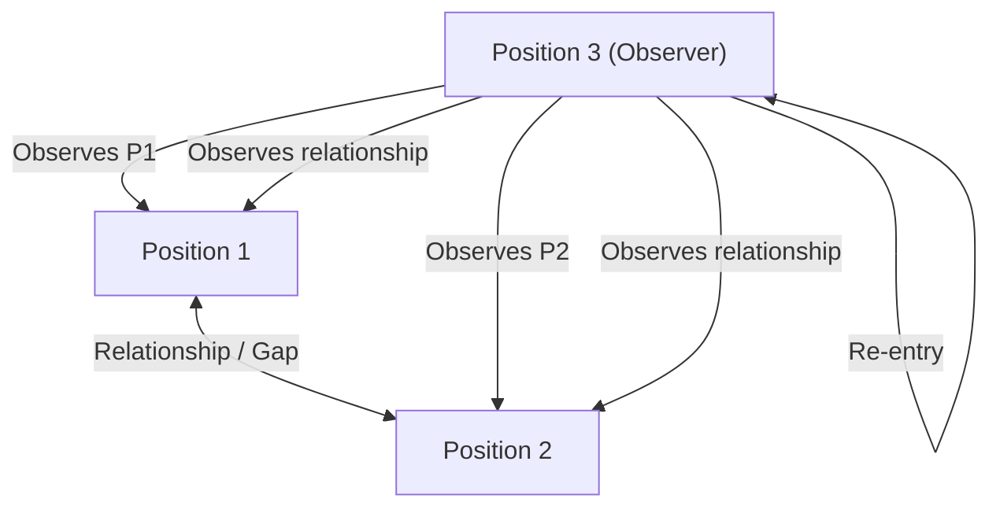
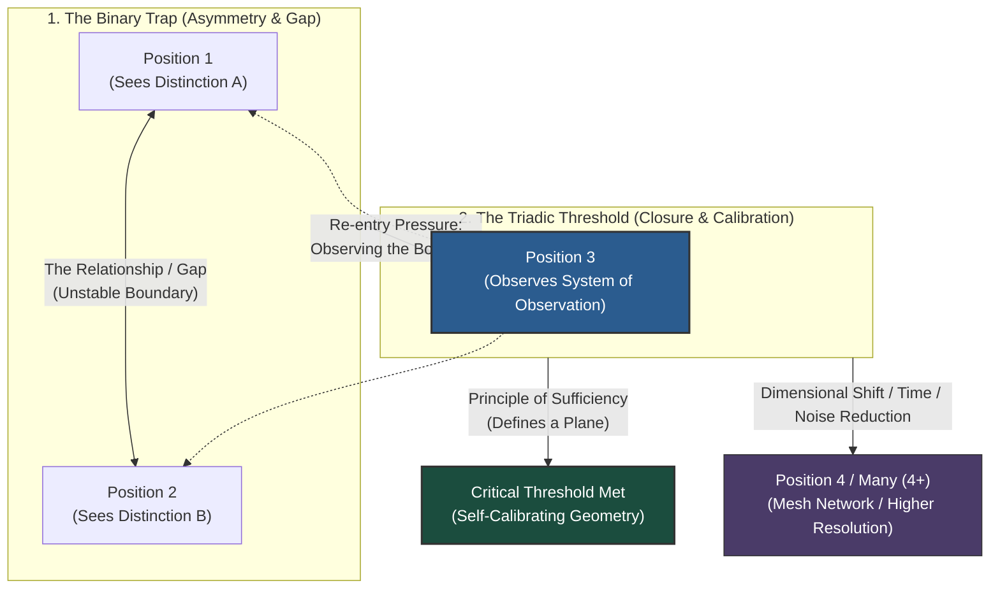

## The Geometry of Perspective: From Single View to Data Triangulation

How we position ourselves as observers fundamentally shapes what we perceive as "reality" or "choice." As you move from a single vantage point to multiple interacting perspectives, the nature of information changes from absolute truth to a dynamic system.

---

### 1. A Single Observer Position (The Illusion of Monolith)

When there is only one observer position, the view is taken as an absolute.

- **What is seen:** A single, flattened projection of reality. Because there is no alternative point of comparison, what is visible is assumed to be the entirety of the objective truth.
- **The Choice:** One choice. Statistically and practically, a single choice is no choice at all—it is an inevitability or an ultimatum. You either accept the single visible option or exist in a vacuum.

### 2. Two Observer Positions (The Binary Risk)

Introducing a second position creates a duality. This is where contrast and comparison begin, but it introduces a major cognitive trap.

- **What is seen:** Two opposing viewpoints or sets of data.
- **The Choice:** A binary choice (A vs. B).
- **The False Dichotomy:** This setup frequently triggers a **false dichotomy**—the mistaken belief that only two mutually exclusive options exist. Because the two positions often look in opposite directions, they create an artificial spectrum where you are forced to choose side A or side B, completely ignoring the space in between or outside the frame.

### 3. Three Observer Positions (The Synthesis of Hidden Data)

When you introduce a third observer position, the system shifts from a rigid tug-of-war to a rich, informational ecosystem. This is where your point about "hidden data" becomes incredibly powerful.

In a three-position framework:

- **The Blind Spots are Information:** What Observer A _cannot_ see (their blind spot) is exactly what Observer B or C can see clearly. Therefore, the fact that something is hidden from one perspective is not a loss of data—it is a diagnostic tool.
- **Cross-Reference and Reveal:** By mapping what each perspective hides, the observers can deduce the exact shape of the object in the center. If Position 1 sees a circle, Position 2 sees a rectangle, and Position 3 sees a specific silhouette, they realize they aren't looking at three different objects, but a single 3D cylinder.

> **The Informational Takeaway:** In a mature data or philosophical system, true understanding doesn't come from just adding up what everyone sees. It comes from analyzing the _gaps_—understanding _why_ a certain perspective hides a specific truth, and using the other perspectives to fill in the blanks.

---

To consistently move from two observer positions to the triadic view, we must look at how the relationship between those first two positions behaves.

When you have **two observer positions**, you have two distinct points of view observing a shared terrain. However, those two positions cannot fully evaluate _their own relationship_ or the structural bias of their pairing without a stabilizing element. The transition to the third position is not arbitrary; it is a structural requirement to resolve the tension or asymmetry between the first two.

Here is how you consistently bridge the gap from two to three, followed by an evaluation of the "one, two, many" progression and whether more positions offer an advantage.

---

## Moving From Two Distinctions to the Triadic View

The mechanism that forces the emergence of the third position relies on **Observer Re-entry** and **Asymmetry**.

When Position 1 and Position 2 record their distinct, coherent views, an unavoidable problem arises: **Who reconciles the difference between them?**

```
[Position 1] <---- (Relationship / Gap) ----> [Position 2]
                            ^
                            |
                        [Position 3]
            (Observes the relationship itself)
```

---



---

1. **The Incompleteness of the Binary:** Position 1 sees distinction $A$. Position 2 sees distinction $B$. Because they are distinct, there is a boundary, a gap, or an asymmetry between them. Position 1 cannot see what Position 2 sees, and vice versa.
2. **Observing the Gap:** To maintain a stable system under "reconstruction pressure," you cannot just let $A$ and $B$ clash. You must observe the _relationship_ or the _boundary_ between $A$ and $B$.
3. **The Necessary Emergence:** The moment you attempt to observe the relationship between Position 1 and Position 2, you have implicitly stepped outside of both. You have generated **Position 3**.

Position 3 does not just look at the terrain; **it observes the system of observation itself.** It maps how the asymmetry between Position 1 and Position 2 behaves. This is how the system achieves "closure"—the triadic view is the minimum architecture required for a system to look at a terrain, notice its own biases, and calibrate itself without relying on an external, absolute truth.

---

## Is There an Advantage to "Many" (More Than Three)?

If three positions grant us stereoscopic, self-calibrating depth, does adding a fourth, fifth, or $N$-th position offer any functional advantage?

In the context of a strict **closure regime** (like the MFHIS framework mentioned), the answer follows a rule of diminishing returns, but with specific architectural advantages in complex terrains.

### 1. The Principle of Sufficiency (Why Three is Often the Limit)

In pure geometry and topology, **three points define a plane.** \* Once you have three positions, you can triangulate any point in that space.

- Adding a fourth position (Position 4) within that same plane generally does not produce _new_ types of distinctions; it merely provides redundant data that confirms the gradients already established by the first three.
- If your goal is structural stability and reconstruction under compression, **three is the leanest, most efficient architecture.**

### 2. When "Many" is an Advantage (Dimensional Shifts)

Adding more positions becomes advantageous only when the terrain itself has higher dimensionality, or when the system experiences extreme "compression pressure."

- **Breaking New Dimensions:** If Positions 1, 2, and 3 have mapped a flat plane, a 4th position is required if it steps _out_ of that plane (e.g., adding depth to a flat surface, or adding the dimension of time/state-change). A 4th position is useful if it observes how the triadic system shifts over time.
- **Error Correction and Noise Reduction:** In data science or physical triangulation (like GPS satellites, which require a minimum of 4 satellites), extra positions are used to cancel out clock errors and environmental noise. If your observing instruments are imperfect, "many" views provide statistical resilience.
- **Mapping Complex Topologies:** If the terrain has sharp folds, occlusion zones, or "shadows" that a single triad cannot pierce, adding further triadic clusters creates a mesh network of observation.

---

Diagram representing the transition from a binary system to a triadic view, along with the progression to higher dimensions.

---



### Key Elements Mapped:

- **The Binary:** Shows `Position 1` and `Position 2` separated by a gap/boundary that they cannot inherently reconcile on their own.
- **The Triad:** `Position 3` emerges by stepping outside the binary plane to observe the relationship itself, achieving structural closure.
- **The N-th Dimension:** Shows how the progression splits—either stabilizing perfectly at the critical threshold of 3, or scaling to `Position 4+` when a dimensional shift or mesh tracking is required.

---

## Summary of the Advantage

| Number of Positions | Structural Output           | Systemic Advantage                                                                          |
| :------------------ | :-------------------------- | :------------------------------------------------------------------------------------------ |
| **One**             | Monolith / Silhouette       | Maximum simplicity, but highly vulnerable to illusions.                                     |
| **Two**             | Contrast / Asymmetry        | Establishes boundaries, but creates a rigid, unstable binary trap.                          |
| **Three**           | **Triangulation / Closure** | **Minimum requirement for self-calibration, resolving blind spots, and mapping topology.**  |
| **Many (4+)**       | Dimensionality / Mesh       | Scalability, noise reduction, and tracking dynamic shifts across time or higher dimensions. |

**The Verdict:** You move from two to three because the relationship between the two _demands_ an observer to stabilize it. Beyond three, you do not get a new _category_ of logic—you simply get higher resolution or a new dimension. For a stable closure regime, **three is the critical threshold.**

---

## The Memphis Sequence

1.  Select a terrain.

Do not define a problem.

Define what is being observed.

2. Record what appears coherent.

   Do not explain it.

3. Identify distinctions.

   Anything that appears separate from something else.

4. Preserve those distinctions before assigning meaning.

5. Change observational position.

   Ask:
   - What disappeared?

   - What remained?

   - What became newly visible?

6. Repeat repositioning until new positions stop producing new distinctions.

7. Observe recurring distinctions.

8. Observe relations between recurring distinctions.

9. Observe gradients implied by those relations.

10. Observe topology implied by those gradients.

11. Observe pressures implied by that topology.

12. Ask:

    > What instrument would preserve visibility of these pressures?

13. Materialize that instrument.

The output is not a theory.

The output is not an explanation.

The output is a domain-specific instrument.

MFHIS names a closure regime that emerges when an observing system must remain stable under compression, observer re-entry, and reconstruction pressure.

---
