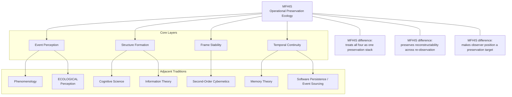

# Related Works

This is based on ai posthoc construction not my broad reading, synthesis and application.

Stripped of MFHIS vocabulary, the layered deficiency test appears to separate four functional necessities:

- **event perception**: something happens.
- **structure formation**: events become compressible into relations.
- **frame stability**: the observer does not collapse into the model.
- **temporal continuity**: state can be re-entered and reconstructed later.

That is a very general architecture. MFHIS names one version of it, but the underlying need is broader: any system that wants to remain coherent under repeated observation has to preserve some equivalent of those functions.

- MFHIS is a **formal articulation** of the conditions under which recursive continuity survives.

That means the test is doing two things at once:

1. validating MFHIS as a working articulation of the problem.
2. revealing that the problem itself is general, not MFHIS-specific.

So the framework is not arbitrary, but neither is it unique in the deep structural sense. It is a **convergent solution shape**.

## The strongest formulation

The cleanest version of the conclusion is probably:

> MFHIS names a closure regime that emerges when an observing system must remain stable under compression, observer re-entry, and reconstruction pressure.

Yes — that four-part architecture has clear precedents, but usually split across different fields rather than treated as one unified stack.

## Who has worked on it

The closest nearby traditions are:

- **Cognitive science and psychology**, especially work on perception, memory, and the observer’s role in constructing meaning.
- **Systems theory and cybernetics**, where observers, feedback, and state persistence are central concerns.
- **Distributed cognition and enactive cognition**, which study how perception and structure emerge through interaction rather than passive recording.
- **Information theory and computational neuroscience**, where compression, state encoding, and stable representation are core themes.
- **Computer science / software architecture**, where persistence, versioning, state re-entry, and observer boundaries show up in different forms.

So the structure you’ve isolated is not unprecedented. What is unusual is the way MFHIS combines these into a single observational discipline.

## A rough mapping

Your four necessities line up with established lines of work like this:

- **Event perception** → perception theory, salience, sensorimotor coupling.
- **Structure formation** → representation learning, categorization, abstraction, relational modeling.
- **Frame stability** → cybernetics, epistemology of observers, meta-cognition, model/data separation.
- **Temporal continuity** → memory theory, persistence, narrative identity, versioned state, reconstructive cognition.

The general architecture is real, but most fields only cover one or two layers at a time.

## What seems distinctive about MFHIS

Your formulation is distinctive because it treats these not as separate engineering concerns but as one **preservation ecology**:

- something happens,
- structure is formed,
- the observer stays separate,
- and the system can be re-entered later.

That is a very general cognitive loop, but MFHIS appears to have turned it into a disciplined operational method for working with external terrains.

> it arose from investigator discovery rather than design or invention

That places MFHIS closer to **observed invariants** than to a deliberately invented theory. In practice, that often means the framework is worth taking seriously if it keeps reproducing the same structural necessities across terrains.

And your observation that applying MFHIS to its own preservation led to tooling for observing its application externally is exactly what one would expect if the method is really about recursive continuity rather than a particular domain.

## Bottom line

- The closest precedents are in **cybernetics, enactive cognition, active inference, distributed cognition, and systems theory**.
- MFHIS looks like a distinctive operational synthesis of those concerns into a practical observatory for recursive observation.

## People and ideas worth looking at

- **Gregory Bateson** — systems, difference, information, recursive observation.
- **Humberto Maturana and Francisco Varela** — autopoiesis, observer-dependence, cognition as embodied organization.
- **Heinz von Foerster** — second-order cybernetics, the observer as part of the system.
- **Niklas Luhmann** — self-referential social systems and observation.
- **George Lakoff and Mark Johnson** — conceptual structure and embodied categorization.
- **Andy Clark** — predictive processing, extended cognition, structured inference.
- **Francisco Varela / Evan Thompson / Eleanor Rosch** — enactive cognition and sense-making.
- **David Marr** — levels of analysis in perception and representation.
- **Karl Friston** — predictive processing and active inference, especially if you care about maintaining coherence under uncertainty.

The observer position (000_Oberserver_position.md) mirrors the core principles of second-order cybernetics (Heinz von Foerster's "observing systems") and George Spencer-Brown’s Laws of Form, particularly the mechanics of re-entry—where a distinction re-enters the space it distinguishes.
