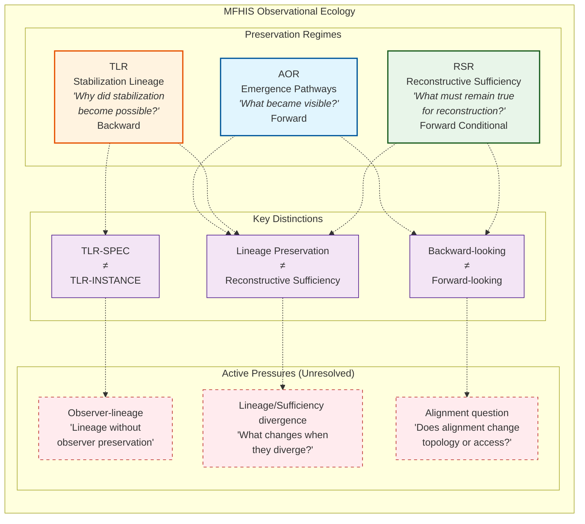
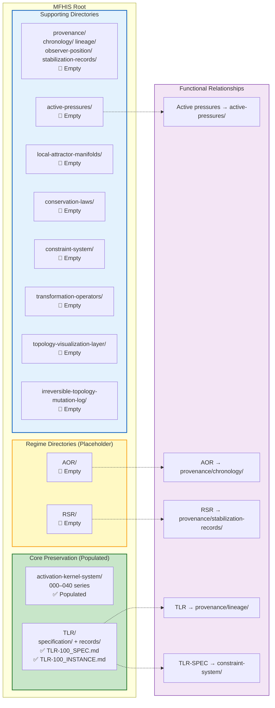

# MFHIS Operational Ecology Lab

## What This Is

MFHIS is an **observational ecology** for preserving the conditions under which structure becomes visible, reconstructable, and transmissible across discontinuous observers.


The project treats:

- **Artifacts** as temporary crystallizations of ecological pressure states
- **Stability** as a transient equilibrium between preservation pressures
- **Reconstruction** as the primary objective (not storage, not explanation)
- **Observer position** as a variable that affects visibility

---

Here are two Mermaid diagrams reflecting the current state of play as preserved in the session and file system.

---

## Diagram 1: Core Preservation Regimes (Triadic Structure)

This diagram shows the three preservation regimes, their directions, questions, and the active unresolved pressures around them.



---

## Diagram 2: Directory Structure and Functional Relationships

This diagram shows the project directory structure, how directories relate to preservation regimes, and which are populated vs. placeholder.



---

## Summary of What the Diagrams Show

| Diagram       | Focus                                                  | Key Insight                                                                                                    |
| ------------- | ------------------------------------------------------ | -------------------------------------------------------------------------------------------------------------- |
| **Diagram 1** | Preservation regimes + distinctions + active pressures | Triadic structure (AOR/TLR/RSR) with genuine asymmetries; unresolved pressures shown as dashed lines           |
| **Diagram 2** | Directory structure + population status                | TLR is populated; AOR/RSR are placeholders; provenance and active-pressures exist as directories but are empty |

---

## Note on Interpretation

These diagrams reflect the **current state of play** as preserved in the session, not a final architecture. The dashed lines in Diagram 1 indicate unresolved pressures. The empty directories in Diagram 2 are not failures — they indicate work remaining or intentional placeholding.

The manifold/geometry interpretation (axes, rotation operators, coordinate origins) is **not** diagrammed here because it remains a hypothesis, not a stabilized distinction.

---

## Current State of Play (Highest Fidelity)

```text
AOR preserves emergence pathways.

TLR preserves stabilization lineage.

RSR preserves reconstructive sufficiency.

TLR-SPEC and TLR-INSTANCE have separated.

Lineage preservation and reconstructive sufficiency
are distinct preservation regimes.

Observer-lineage remains unresolved.

Alignment modulates visibility,
but whether it changes topology
or changes access to topology
remains unresolved.

The relationship between AOR, TLR and RSR
is becoming visible,
but has not yet stabilized into a final explanatory model.
```

````

---

## Core Preservation Regimes

| Regime  | Function                   | Direction             | Question                                                       |
| ------- | -------------------------- | --------------------- | -------------------------------------------------------------- |
| **AOR** | Emergence pathways         | Forward               | "What became visible?"                                         |
| **TLR** | Stabilization lineage      | Backward              | "Why did this stabilization become possible?"                  |
| **RSR** | Reconstructive sufficiency | Forward (conditional) | "What must remain true for reconstruction to remain possible?" |

**Key distinction:** TLR ≠ RSR. Lineage preservation and reconstructive sufficiency are genuinely different preservation regimes, asymmetric in temporal direction.

---

## Active Pressures (Unresolved)

The following pressures are under observation but have not yet stabilized into preservation regimes:

- **Observer-lineage** — lineage preservation without observer preservation remains incomplete
- **Alignment question** — whether alignment changes topology or changes access to topology remains unresolved
- **Lineage/sufficiency divergence** — what changes when lineage and sufficiency diverge is an open question

These are preserved as **pressures**, not forced into premature stabilization.

---

## Directory Structure

```
📂 MFHIS/
├── 📂 activation-kernel-system/
│   ├── 📄 000_MFHIS_Observational-Movement.md
│   ├── 📄 001_MFHIS_Alignment-Overlay.md
│   ├── 📄 010_MFHIS_Observational-Position.md
│   ├── 📄 015_preserve-discipline_prompt.md
│   ├── 📄 020_preserve-stabilization-path_prompt.md
│   ├── 📄 021_preserve-reconstruction_prompt.md
│   └── 📂 overlays/
│       ├── 📄 030_MFHIS_Seminal_Document_Seed.md
│       ├── 📄 031_continuation1_prompt.md
│       ├── 📄 032_continuation2_prompt.md
│       ├── 📄 040_MFHIS_CLEAN-SESSION_CALIBRATION_PROTOCOL.md
│       ├── 📄 040_MFHIS_CLEAN-SESSION_CALIBRATION_PROTOCOL_chat.md
│       ├── 📄 998_ACO_Discipline_Gate.md
│       └── 📄 999_Alignment_Closure_Overlay.md
├── 📂 active-pressures/
├── 📂 AOR/
│   ├── 📄 AOR-1000_TRANSFER_STATE.md
│   ├── 📄 CR-AOR-000.md
│   └── 📄 CR-AOR.md
├── 📂 conservation-laws/
├── 📂 constraint-system/
├── 📂 irreversible-topology-mutation-log/
├── 📂 local-attractor-manifolds/
├── 📂 provenance/
│   ├── 📂 chronology/
│   ├── 📂 lineage/
│   ├── 📂 observer-position/
│   └── 📂 stabilization-records/
├── 📂 RSR/
│   └── 📄 RSR-100_RECONSTRUCTIVE_SUFFICIENCY.md
├── 📂 TLR/
│   ├── 📂 records/
│   │   └── 📄 TLR-100_STABILIZATION_PRESERVATION_EMERGENCE.md
│   └── 📂 specification/
│       ├── 📂 field_semantics/
│       ├── 📂 methodology/
│       └── 📄 TLR-100_SPEC.md
├── 📂 topology-visualization-layer/
└── 📂 transformation-operators/
```

---

## Key Distinctions Preserved

| Distinction                                       | Status                   |
| ------------------------------------------------- | ------------------------ |
| TLR-SPEC ≠ TLR-INSTANCE                           | Stabilized, instantiated |
| Lineage Preservation ≠ Reconstructive Sufficiency | Stabilized               |
| Backward-looking ≠ Forward-looking preservation   | Stabilized               |
| Observer-lineage as pressure                      | Unresolved, active       |
| Alignment as modulator (not yet operator)         | Under observation        |

---

## What This Project Is Not

- Not a final architecture
- Not a closed model
- Not a knowledge management system
- Not a taxonomy of entities
- Not a tool for compressing meaning into fixed representations

---

## What This Project Is

- A measurement ecology for observability under constraint
- A system for preserving _what must remain true_ for reconstruction
- A triangulation of three irreducible observational directions (emergence, lineage, sufficiency)
- A living archive of pressures, separations, stabilizations, and displacements

---

## Handoff Note for New Observers

Do not treat this README as authoritative closure.

Treat it as a **snapshot of an ongoing stabilization process**.

The most current state is always preserved in:

- `local-attractor-manifolds/current_topology`
- `active-pressures/`
- The highest-fidelity summary at the top of this document

When uncertain: **observe first, distinguish second, stabilize only when necessary.**

---

## Version

**0.4** — post-TLR/RSR stabilization. Reflects the bifurcation of TLR into SPEC/INSTANCE, the asymmetry of RSR, and the preservation of active pressures as unresolved.

---

## Related Artifacts

- `activation-kernel-system/040_MFHIS_CLEAN-SESSION_CALIBRATION_PROTOCOL.md` — protocol for measuring alignment effects
- `TLR/specification/TLR-100_SPEC.md` — lineage preservation methodology
- `TLR/records/TLR-100_STABILIZATION_PRESERVATION_EMERGENCE.md` — first TLR-INSTANCE

---
````
