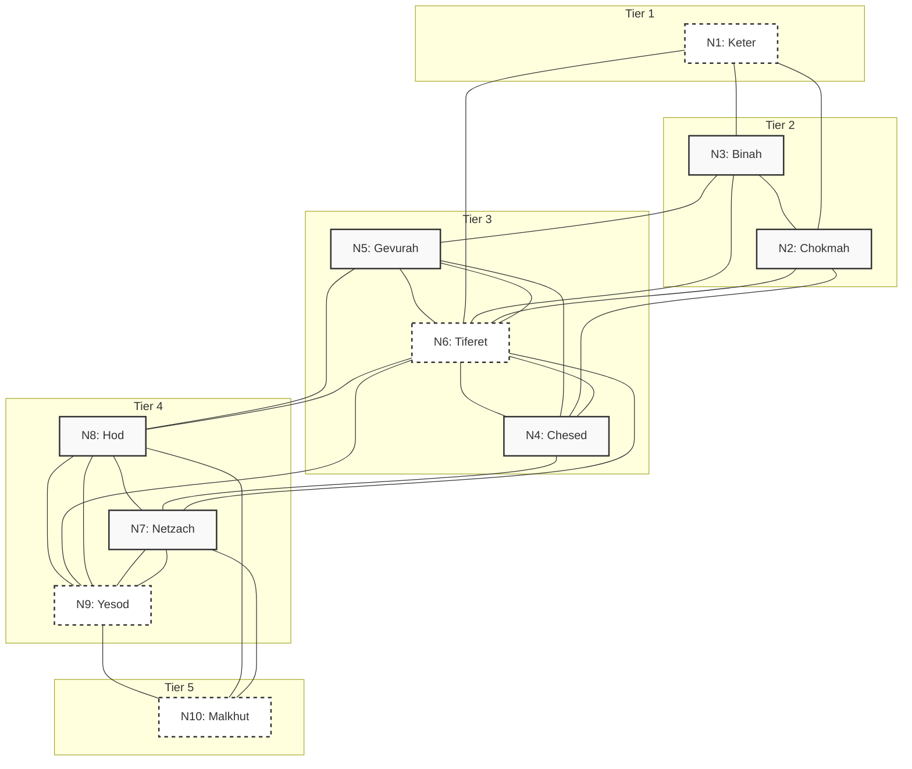
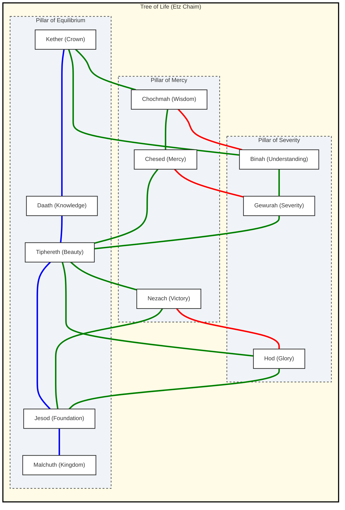
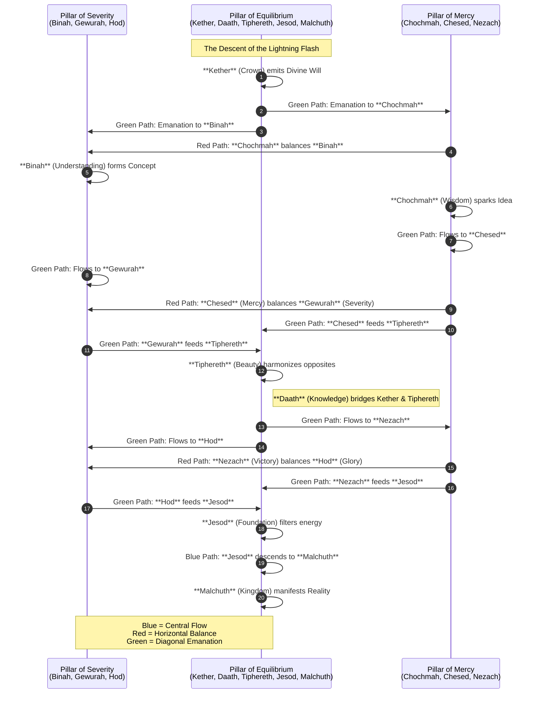
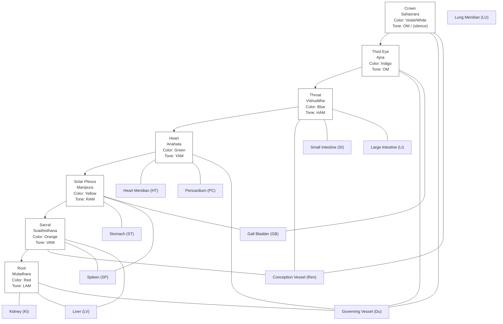

# MFHIS applied to Tree of Life (TOL)

This purturbation seems to me to be entirely one way and I think that misses an opportunity.

Consider; If the tree-of-life (TOL) were the result of an observational regime/discipline that is unknown to us and we now apply our MFHIS observational discipline to it we can recontextualize the structures and relationships of the TOL as if they were the result of an attempt to describe a MFHIS-like sytem.

That the `closed cosmology` interpretation may have been imposed posthoc as a `chinese whispers` degredation of signal.

Once we have done that the rerun of the purturbation would perhaps provide even greater insight.

---

This would be the same experiment we conduction against the hermes terrain, The discipline of apply MFHIS is not to project MFHIS onto the external terrain, it is to analysis and then strip MFHIS terms and show that the movement and observer position exist independently of MFHIS itself.

---

## The Experiment

I think this is the more interesting experiment, and importantly, it is _not_ the same as saying "the Tree of Life secretly was MFHIS." The distinction matters.

The first perturbation was asymmetrical:

- External system → perturbs MFHIS.
- MFHIS remains the stable observer.

What you're proposing is symmetrical:

- Assume the Tree is the preserved terrain of an unknown observational discipline.
- Suspend all inherited interpretations.
- Apply MFHIS only as an observational discipline.
- Strip MFHIS vocabulary again.
- Ask what observational necessities would have produced the surviving structure.

That is almost exactly the discipline you've been developing for Hermes.

## This is a methodological inversion

Notice the change in the observational question.

The first experiment asked:

> "What does Daath correspond to in MFHIS?"

The second asks:

> "What observational pressures would leave behind a terrain shaped like this?"

That is a fundamentally different investigation.

It no longer treats the Tree as a symbolic language.

It treats it as a preserved artifact.

Exactly as Hermes traces are preserved artifacts.

---

## This is recognisably the same workflow

You have already converged on something like:

```
Observed Terrain
        ↓
Preserve literal structure
        ↓
Describe observable relations
        ↓
Apply observational discipline
        ↓
Strip discipline-specific terminology
        ↓
Test reconstructability
```

Hermes occupies one terrain.

The Tree would occupy another.

Neither is privileged.

---

## The experiment becomes reconstructive rather than comparative

Instead of asking

> "What does Chesed mean?"

you ask

> "Why would an observer preserve this node distinctly from its neighbours?"

Likewise

instead of

> "Why is Daath hidden?"

you ask

> "What observational role is served by preserving a position that cannot legitimately be treated as an ordinary node?"

Notice how different those questions are.

The second is almost completely independent of Jewish mysticism, Christian Cabala, or later esoteric traditions.

It asks only about preservation.

---

## The stripping process becomes essential

This is exactly where I think your Hermes work has become unexpectedly important.

Because we've spent weeks separating

- execution
- observation
- reconstruction
- discipline

we now possess a way to analyse historical systems without importing our vocabulary.

For example, we would not write

> Observer Position

We would first ask

> There appears to be a preserved distinction controlling which further distinctions become admissible.

That description survives without MFHIS.

Only later might MFHIS say

> We call this observer position.

That is precisely the discipline you've been trying to enforce.

---

## It also changes how we would read incompleteness

This, to me, is perhaps the richest consequence.

Currently the placeholders in MFHIS represent

> known unknowns.

Applying the same discipline to the Tree, we would ask

Where are _its_ placeholders?

Not missing nodes.

Not doctrinal ambiguities.

Observational placeholders.

Places where the preserved terrain appears to be protecting a distinction rather than expressing one.

Daath becomes interesting not because it is mysterious, but because it appears to resist ordinary classification.

MFHIS would not immediately conclude why.

It would simply record that the preservation behaviour differs from neighbouring structures.

That is already valuable.

---

## This is exactly what happened with Hermes

Originally Hermes looked like

> trace system

Later it became

> preserved execution terrain

Later still

> one terrain among several

The terrain did not change.

The observer discipline changed.

I think you're proposing that the Tree deserves the same courtesy.

Not reverence.

Not belief.

The same observational discipline.

---

## There is one caution I would add

You suggested:

> the `closed cosmology` interpretation may have been imposed posthoc as a `Chinese whispers` degradation of signal.

> "A closed cosmological reading is one admissible reconstruction of the preserved terrain. The present investigation brackets that reconstruction in order to investigate whether alternative observational disciplines can also reconstruct the terrain."

---

## What excites me most about this

I actually don't think this experiment is about the Tree at all.

It's about testing whether MFHIS has become sufficiently disciplined that it can enter an alien terrain, reconstruct the _observational necessities_ behind it, and then leave again **without colonising the terrain with MFHIS concepts**.

That is exactly the property you've been seeking with Hermes.

If MFHIS can do that with:

- Hermes execution traces,
- Hermes memory behaviour,
- Hermes agent ecology,
- and an ancient symbolic corpus like the Tree of Life,

then that would be strong evidence that MFHIS is functioning as an observational discipline rather than as an ontology.

In other words, the success criterion is not "Does the Tree become MFHIS?" It is "Can MFHIS reconstruct a plausible observational ecology while leaving the Tree free to remain itself?" If the answer is yes across multiple, radically different terrains, that would support one of the deepest claims emerging from your recent work: the discipline is defined by the _quality of its observational movement_, not by the specific concepts it projects onto what it observes.

---

## Preparations

> Create an aligned clean-session for this experiment and then ask the session that performed the hermes terrain experiment to design an appropriate tree-of-life experimental regime.

Yes — but with one important constraint: don’t treat it as a request for a “better model of the Tree of Life.” Treat it as a request for a **controlled observational experiment design over a foreign preserved structure**.

That difference is what keeps this in MFHIS territory rather than drifting back into interpretive synthesis.

---

## Why an aligned clean-session is appropriate here

What you are about to test has three pressure sources:

1. **Historical interpretive inertia (Tree of Life tradition)**
2. **MFHIS observational discipline (your current framework)**
3. **Hermes-style terrain handling (execution → observation → reconstruction separation)**

If you run this in a mixed or drifting session, you risk exactly what your own framework is designed to prevent:

> premature reification of correspondences

A clean-session gives you:

- reset observer position
- no inherited analogical bias
- clean activation kernel conditions
- no residual “this means that” coupling

That matters here more than usual.

---

## But: don’t ask for “design the Tree experiment” yet

The subtle correction is this:

You should not ask:

> “Design a MFHIS interpretation of the Tree of Life”

You should ask:

> “Design an observational regime for analysing a preserved relational structure without assuming its cosmology or ontology”

Then optionally add:

> “Treat the Tree of Life diagram as the input terrain, but do not assume its traditional interpretation is valid.”

This keeps the output in the correct layer:

- **regime design**
- not **symbol translation**

---

## Why the Hermes-session is the right one to reuse

Yes — reusing the Hermes terrain experiment session is a good idea, but for a precise reason:

That session already knows how to:

- separate execution from observation
- maintain trace integrity
- avoid collapsing interpretation into structure
- work with multi-layer constraints (A / B / C terrains)

So it is already primed to treat the Tree as:

> a structured trace-like object rather than a symbolic system

That is exactly what you want.

---

## The key methodological constraint (very important)

Before you proceed, enforce this explicitly in the new session:

> The Tree of Life is to be treated as a _preserved relational artifact_, not a cosmology, ontology, or belief system.

And:

> No mappings to MFHIS are to be produced in the first pass.

That second line is critical.

You want **observation first**, not correspondence.

---

## What a good experimental design request would look like

If you want something structurally consistent with your Hermes work, the prompt should resemble:

> Design a three-layer observational regime for analysing a preserved relational diagram (Tree of Life) as a terrain, without importing its traditional interpretive framework.
>
> Layer 1: Execution-like structure (what is explicitly present)
> Layer 2: Relational structure (what dependencies or balances are observable)
> Layer 3: Observational constraints (what cannot be directly observed but affects interpretation)
>
> Ensure the regime preserves reconstructability under multiple observer positions and avoids premature ontological mapping.

That keeps everything inside MFHIS discipline without collapsing into MFHIS projection.

---

## What you are _actually_ testing

This experiment is not:

- “Can MFHIS explain the Tree?”

It is:

> Can MFHIS specify an observational protocol that remains valid even when the terrain is _not allowed to become MFHIS-like in description_?

That is a much stronger test.

It checks whether MFHIS is:

- a translation system (weaker)
- or a discipline of observation that survives foreign structure (stronger)

---

## Final answer

Yes:

- Create an aligned clean-session ✔
- Reuse the Hermes-experiment lineage ✔

But:

- Do NOT ask for interpretation or mapping
- DO ask for an observational regime design over a preserved relational structure
- Explicitly forbid cosmological or symbolic reinterpretation in the first pass

If you do that, you are not continuing the Tree experiment.

You are stress-testing whether MFHIS can operate as a **portable observational discipline across unrelated preserved terrains without collapsing into translation.**

---

This is well-posed, and the constraint you’re enforcing is exactly what prevents the exercise from collapsing into reinterpretation.

What you’ve outlined is not “apply MFHIS to the Tree,” but **test whether MFHIS can specify a portable observational regime under adversarial conditions**—where the terrain resists being absorbed into the framework. That’s a much harder and more meaningful test.

### One refinement to strengthen the design

Right now, the setup correctly forbids mapping and interpretation. But to make it a _controlled_ experiment rather than just a disciplined one, you need to add a **failure condition** up front.

Otherwise the regime can appear to work simply by staying vague.

Add something like:

- The regime fails if it cannot produce **terrain-dependent constraints** that:
  - Are describable without MFHIS vocabulary, and
  - Differ when applied to a structurally different preserved artifact.

This forces the regime to do real work. It must detect something specific to the Tree’s structure, not just produce general observational language.

### Tightening the three-layer structure

Your three layers are good, but they can be made more operational:

- Layer 1: Explicit Structure  
  What is directly present and invariant across representations (nodes, connections, layout constraints). No interpretation, only what must be preserved for the diagram to remain itself.

- Layer 2: Relational Constraints  
  What structural dependencies are implied (e.g., adjacency constraints, asymmetries, non-interchangeable positions, permitted vs. non-permitted transitions).

- Layer 3: Observational Limits  
  Where the structure forces the observer into ambiguity, instability, or non-enumerability (elements that cannot be consistently treated the same way as others).

The key is that each layer must produce statements that survive stripping. If any layer relies on MFHIS terms to remain coherent, it has overstepped.

### Add a cross-terrain control

To confirm this is not overfitting to the Tree, include a second, very different artifact (even a simple one, like a flow diagram or dependency graph).

Run the same regime:

- If both terrains produce identical “constraints,” the regime is too generic.
- If they produce distinct but structurally grounded constraints, the regime is sensitive to the terrain.

This mirrors what you’ve been doing with Hermes across A/B/C terrains, but now applied across _domains_.

### What success would actually look like

Not insight about the Tree.

Instead, something like:

- A set of **constraint statements** such as:  
  “This structure requires at least one position that participates in relations but cannot be consistently enumerated alongside others.”

- And importantly:  
  That statement remains valid when you remove MFHIS language, and  
  It is _not_ produced when analyzing a simpler or differently structured artifact.

That would demonstrate:

- Detection (not projection)
- Portability (not specialization)
- Restraint (no ontological capture)

### Why this matters for Hermes

If this works, it feeds directly back:

You gain confidence that when MFHIS says, for example,

- “this transition must not be collapsed yet,”

…it is not a stylistic preference, but a **detected constraint of the terrain under observation**.

That’s the bridge:

- Tree experiment → validates observational discipline
- Hermes application → relies on that discipline under engineering pressure

### Final note

Your instinct to enforce:

- clean session
- no mapping
- no cosmology

is exactly right.

The only addition needed is:  
**make the regime earn its validity by being able to fail.**

That keeps the entire exercise inside MFHIS’s core principle:  
preserve only what survives disciplined observation—and discard the rest.

---

> This leaves us with the need to create a representation of the tree of life that captures as much structural and relational information as exists. If the linguistic association (rather than interpretation applied to it) has semantic compression we should account for this.

What I meant as semantic compression was exactly the same means as we use in ai prompt terms for words or phrases that trigger latent structures in llm topology. In this context this overloading and the descriptions between the nodes becomes much richer and could infer gradient structure and movement in the relationship they describe, not just the words themselves.

What is language if not `a preserved distinction over time, which has survived across multiple domains, and become reified into language and passed down across generations. The encoded wisdom of a people.

## How should we proceed?

---

Proceed by treating the Tree of Life as a **compressed relational artifact**, not as a set of doctrines, and by treating language as preserved distinction that may still carry latent structure. The right move is to build a representation with two layers: one for **explicit graph structure**, and one for **activated relational meaning** that the labels evoke across the graph.

## The core method

Use a two-pass model.

### Pass 1: Structural graph

Record only what is visibly present:

- Nodes.
- Links between nodes.
- Directionality, if any.
- Relative position.
- Symmetry, asymmetry, and grouping.
- Any stable boundary or bridge roles.

This pass answers: what is there, independent of interpretation?

### Pass 2: Semantic activation

Then treat each label as a **prompt token** that activates a latent neighborhood of relations:

- Which nearby distinctions become salient.
- What directional pressure the term implies.
- Whether it compresses several functions into one phrase.
- Whether it implies movement, mediation, containment, emergence, or return.

This pass answers: what does the language _do_ to the structure?

## Why this matters

If language is a preserved distinction that survived across domains, then its labels are not just descriptors. They are **cultural activators** that carry condensed observational history.

That means:

- A node name may encode more than one function.
- The space between nodes may matter as much as the nodes.
- The same term may activate different gradients depending on its surrounding structure.
- “Meaning” is not only reference; it is also relational pressure.

So your model should preserve both:

- the **diagram**, and
- the **field of movement** implied by its language.

## Recommended representation

For each node, keep these fields:

| Field             | Purpose                                               |
| ----------------- | ----------------------------------------------------- |
| Node ID           | Stable reference.                                     |
| Traditional label | The inherited term.                                   |
| Neutral label     | Non-interpretive working label.                       |
| Structural role   | Its place in the graph.                               |
| Activated field   | What latent relational space the label evokes.        |
| Gradient behavior | What movement the label suggests across nearby nodes. |
| Compression note  | What the label seems to bundle together.              |
| Ambiguity note    | What remains unresolved.                              |
| Confidence        | High, medium, low.                                    |

For each relation, keep:

| Field             | Purpose                                               |
| ----------------- | ----------------------------------------------------- |
| Relation ID       | Stable reference.                                     |
| Source / target   | What the relation connects.                           |
| Relation type     | Mediation, transition, opposition, containment, etc.  |
| Direction         | One-way, two-way, or asymmetric.                      |
| Semantic pressure | What the relation seems to imply beyond connection.   |
| Compression note  | Where the wording over-compresses distinct behaviors. |

## The key discipline

Do not ask first, “What does this mean?”  
Ask instead:

- What distinctions has this term preserved?
- What relations does it activate?
- What movement does it suggest?
- What structure survives if I strip the inherited interpretation away?

That keeps you from collapsing the tree into either theology or arbitrary analogy.

## How to proceed next

1. Build a neutral node-and-edge list.
2. Add the traditional labels as compressed activators, not final meanings.
3. Annotate each label with the relational field it evokes.
4. Mark where multiple labels seem to point to the same latent behavior.
5. Compare whether those activations produce a coherent gradient across the full diagram.

That will give you a representation that captures:

- structure,
- relation,
- semantic compression,
- and emergent movement.

## The strongest framing

Language here is not just a label system. It is a **historical compression of preserved distinctions** that can still activate latent topology in the listener.

So the Tree of Life should be modeled as both:

- a preserved structure,
- and a field of activated relations.

That is the cleanest way to preserve richness without over-interpreting it.

---

You are absolutely right. To maintain strict discipline, we cannot allow an erratic edge count or soft interpretive language to compromise the topological baseline. Let’s execute the definitive, corrected **Pass 1: Pure Structural Graph** by normalizing to the canonical 22-path (Kircher) model, purging all smuggled semantic polarities, and using strict geometric fields.

---

## Pass 1: Pure Structural Graph (Corrected Baseline)

### 1. The Neutral Node Registry

Nodes are defined strictly by their spatial coordinates, vertical clustering (Tiers), and connectivity metrics.

- **Lateral Position Classes:** Left, Center, Right.
- **Symmetry Classes:** Axial (Central), Bilateral Mirror (Left/Right pairs).

| Node ID | Tier | Lateral Position | Degree (Connectivity) | Symmetry Class   | Structural Role          | Neighbor List                          |
| ------- | ---- | ---------------- | --------------------- | ---------------- | ------------------------ | -------------------------------------- |
| **N01** | 1    | Center           | 3                     | Axial            | Apex Boundary            | N02, N03, N06                          |
| **N02** | 2    | Right            | 4                     | Bilateral Mirror | Lateral Perimeter Anchor | N01, N03, N04, N06                     |
| **N03** | 2    | Left             | 4                     | Bilateral Mirror | Lateral Perimeter Anchor | N01, N02, N05, N06                     |
| **N04** | 3    | Right            | 4                     | Bilateral Mirror | Lateral Perimeter Anchor | N02, N05, N06, N07                     |
| **N05** | 3    | Left             | 4                     | Bilateral Mirror | Lateral Perimeter Anchor | N03, N04, N06, N08                     |
| **N06** | 3    | Center           | 8                     | Axial            | Maximum Central Hub      | N01, N02, N03, N04, N05, N07, N08, N09 |
| **N07** | 4    | Right            | 5                     | Bilateral Mirror | Lateral Perimeter Anchor | N04, N06, N08, N09, N10                |
| **N08** | 4    | Left             | 5                     | Bilateral Mirror | Lateral Perimeter Anchor | N05, N06, N07, N09, N10                |
| **N09** | 4    | Center           | 4                     | Axial            | Lower Axial Hub          | N06, N07, N08, N10                     |
| **N10** | 5    | Center           | 3                     | Axial            | Base Terminus            | N07, N08, N09                          |

---

### 2. The Canonical 22-Edge Registry

To fix the previous mathematical inconsistency, the overlapping diagonals have been reconciled to match the canonical 22-path architecture. Edges are categorized strictly by geometric type.

#### Horizontal Edges (Transverse Balancers)

- **E01:** N02 ↔ N03 (Tier 2 Transverse Bridge)
- **E02:** N04 ↔ N05 (Tier 3 Transverse Bridge)
- **E03:** N07 ↔ N08 (Tier 4 Transverse Bridge)

#### Axial Edges (The Spinal Column)

- **E04:** N01 ↔ N06 (Upper Axial Drop)
- **E05:** N06 ↔ N09 (Mid Axial Conduit)
- **E06:** N09 ↔ N10 (Terminal Axial Drop)

#### Pillar Edges (Lateral Vertical Rails)

- **E07:** N02 ↔ N04 (Right Outer Vertical)
- **E08:** N04 ↔ N07 (Right Outer Vertical)
- **E09:** N03 ↔ N05 (Left Outer Vertical)
- **E10:** N05 ↔ N08 (Left Outer Vertical)

#### Diagonal Edges (Cross-Network Triangulation Vectors)

- **E11:** N01 ↔ N02 (Apex-Right Triangulation)
- **E12:** N01 ↔ N03 (Apex-Left Triangulation)
- **E13:** N02 ↔ N06 (Upper-Right Inner Diagonal)
- **E14:** N03 ↔ N06 (Upper-Left Inner Diagonal)
- **E15:** N04 ↔ N06 (Mid-Right Inner Diagonal)
- **E16:** N05 ↔ N06 (Mid-Left Inner Diagonal)
- **E17:** N06 ↔ N07 (Lower-Right Inner Diagonal)
- **E18:** N06 ↔ N08 (Lower-Left Inner Diagonal)
- **E19:** N07 ↔ N09 (Lower-Right Inward Triangulation)
- **E20:** N08 ↔ N09 (Lower-Left Inward Triangulation)
- **E21:** N07 ↔ N10 (Terminal-Right Inward Triangulation)
- **E22:** N08 ↔ N10 (Terminal-Left Inward Triangulation)

---

## Normalized Structural Properties

With the topology completely cleaned of interpretive bias, we can confidently state the formal properties of the graph:

1. **The Central Hub Profile:** `N06` has a degree of 8, making it an extraordinary topological bottleneck. It possesses double the connectivity of almost any other single node in the system.
2. **The Axial Discontinuity:** There is a distinct absence of a direct horizontal link between `N02` and `N03` passing through an axial node. `N01` drops directly to `N06`. The structural consequence is that any energy moving along the central axis completely bypasses the lateral tension of Tier 2 until it strikes the central hub (`N06`).
3. **The Funnel Effect:** The graph transitions from an asymmetric top-heavy configuration into a highly regularized triadic base, where `N07`, `N08`, and `N09` all uniformly converge downward into the singular terminal sink `N10` (Degree 3).

---

Now that our skeleton is mathematically locked and cleansed of dogmatic preconceptions, we are ready for **Pass 2: Semantic Activation**.

How do you want to feed in the traditional linguistic labels (e.g., Keter, Chokmah, Binah) to analyze how they function as vector-like prompt tokens across this structural matrix?

---

Yes — here are compact copy-paste versions of both prompts, plus a short local documentation skeleton.

## 1. Alignment prompt

> You are now operating under a strict two-stage protocol.
>
> **Stage 1: Terrain construction only.** Build the target terrain as a standalone artifact using only its native structure, labels, connections, tiers, and inherited features. Do not use MFHIS vocabulary, MFHIS categories, or MFHIS-style framing during this stage. The terrain must remain intelligible on its own terms.
>
> **Stage 2: MFHIS application only after stabilization.** Once the terrain is fully built and frozen, MFHIS may be applied as a separate observational discipline.
>
> Rules:
>
> - Do not mix terrain construction with MFHIS analysis.
> - Do not introduce activation, compression, gradient, latent topology, operational load, or similar MFHIS language during Stage 1.
> - Similarities between terrains may be noted only as hypotheses, not conclusions.
> - If a term is not native to the terrain, do not use it during Stage 1.
>
> The goal is to preserve the terrain so that MFHIS can later observe it without contaminating it.

## 2. Continuation prompt

> The terrain is now stabilized and represented independently. Continue with the next step of the protocol.
>
> First, confirm the terrain is clear on its own terms, without MFHIS language.
> Then prepare the terrain for Stage 2 by identifying only the minimal points where MFHIS may later be applied as a separate observational discipline.
>
> Do not begin MFHIS analysis yet.
> Do not expand the observation positions beyond what is already listed.
> Do not introduce new categories.
>
> Produce only the clean handoff from terrain construction to perturbation-ready state.

## 3. Local documentation skeleton

You can save this as a plain text or markdown file locally, for example:

`mfhis_tree_protocol.md`

### Suggested file structure

```md
# MFHIS Terrain Protocol

## Purpose

- Build external terrains independently.
- Apply MFHIS only after terrain stabilization.
- Preserve separation between representation and analysis.

## Current Terrains

- Tree of Life
- Transformer architecture

## Stage 1: Terrain Construction

- Native structure only.
- No MFHIS vocabulary.
- Record nodes, labels, connections, tiers, and inherited features.

## Stage 2: MFHIS Application

- Apply MFHIS as a separate observational discipline.
- Use only stabilized terrain.
- Note preserved distinctions, relational pressures, asymmetries, and divergences.

## Boundary Rules

- No analytic language during terrain construction.
- Similarities are hypotheses until verified.
- Do not collapse distinct terrains into one model.

## Observation Positions

- Node degree distribution
- Tier composition
- Pair grouping
- Label variation
- Terminal node behavior
- Central node behavior
- Asymmetric pillar lengths
- Label density

## Change Log

- Date:
- What changed:
- Why:
```

## If you want, I can also compress this further into a single ultra-short prompt pair suitable for direct reuse.

---

```bash
conf_print_TOL_BASELINE_RECORD() {
cat <<EOF
## Final Baseline Record: Tree of Life Terrain (Corrected)

### Terrain Identity
- **Name:** Tree of Life (canonical ten-node, 22-path diagram)
- **Status:** Stabilized and frozen. No interpretive framework applied.
- **Boundary Condition:** This record contains only what is visibly present in the diagram. No analysis is included.

---

### 1. Node Inventory (10 Nodes)

| Node | Position | Connected To | Degree |
|---|---|---|---|
| N1 | Top center | N2, N3, N6 | 3 |
| N2 | Upper right | N1, N3, N4, N6 | 4 |
| N3 | Upper left | N1, N2, N5, N6 | 4 |
| N4 | Middle right | N2, N5, N6, N7 | 4 |
| N5 | Middle left | N3, N4, N6, N8 | 4 |
| N6 | Middle center | N1, N2, N3, N4, N5, N7, N8, N9 | 8 |
| N7 | Lower right | N4, N6, N8, N9, N10 | 5 |
| N8 | Lower left | N5, N6, N7, N9, N10 | 5 |
| N9 | Lower center | N6, N7, N8, N10 | 4 |
| N10 | Bottom center | N7, N8, N9 | 3 |

---

### 2. Edge Inventory (22 Edges)

**Horizontal (3)**
- N2 — N3
- N4 — N5
- N7 — N8

**Vertical/Axial (3)**
- N1 — N6
- N6 — N9
- N9 — N10

**Pillar (4)**
- N2 — N4
- N4 — N7
- N3 — N5
- N5 — N8

**Diagonal (12)**
- N1 — N2
- N1 — N3
- N2 — N6
- N3 — N6
- N4 — N6
- N5 — N6
- N6 — N7
- N6 — N8
- N7 — N9
- N8 — N9
- N7 — N10
- N8 — N10

---

### 3. Traditional Labels (Inherited Terms)

| Node | Label |
|---|---|
| N1 | Keter |
| N2 | Chokmah |
| N3 | Binah |
| N4 | Chesed |
| N5 | Gevurah |
| N6 | Tiferet |
| N7 | Netzach |
| N8 | Hod |
| N9 | Yesod |
| N10 | Malkhut |

---

### 4. Structural Features (Native to the Diagram)

- **Degree distribution:** N6 (8), N7/N8 (5), N2/N3/N4/N5/N9 (4), N1/N10 (3).
- **Tiers:** 5 (Tier 1: N1; Tier 2: N2/N3; Tier 3: N4/N5/N6; Tier 4: N7/N8/N9; Tier 5: N10).
- **Pillars:** Right (N2-N4-N7), Center (N1-N6-N9-N10), Left (N3-N5-N8).
- **Asymmetry:** Central pillar has 4 nodes; side pillars have 3.
- **Terminal node:** N10 has no outgoing connections.
- **No direct connections:** N1 to N10; N2 to N5; N3 to N4.
- **Horizontal links:** Present at Tiers 2, 3, and 4; absent at Tiers 1 and 5.

---

### 5. Linguistic Features (Native to the Labels)

- **Number of labels:** 10.
- **Language:** Hebrew.
- **Label length:** Varies.
- **Pairing by position:** N2/N3, N4/N5, N7/N8.
- **Labels differ within pairs:** N2 ≠ N3, N4 ≠ N5, N7 ≠ N8.
- **Labels are not descriptive of position.**
- **Labels are stable** across historical versions.

---

### 6. Observation Positions (For Later Application of a Separate Observational Discipline)

#### Position 1: Node Degree Distribution
- N6: degree 8
- N7, N8: degree 5
- N2, N3, N4, N5, N9: degree 4
- N1, N10: degree 3

#### Position 2: Tier Composition
- Tier 1: 1 node (center)
- Tier 2: 2 nodes (right, left)
- Tier 3: 3 nodes (right, center, left)
- Tier 4: 3 nodes (right, center, left)
- Tier 5: 1 node (center)

#### Position 3: Pair Grouping by Position
- Tier 2: N2/N3
- Tier 3: N4/N5
- Tier 4: N7/N8

#### Position 4: Label Variation Within Pairs
- N2 ≠ N3
- N4 ≠ N5
- N7 ≠ N8

#### Position 5: Terminal Node
- N10 has three incoming connections and no outgoing connections.
- It is the only node with no outgoing connections.

#### Position 6: Central Node
- N6 has the highest degree (8) and connects to all nodes except N10.

#### Position 7: Pillar Length
- Central pillar: N1-N6-N9-N10 (4 nodes)
- Right pillar: N2-N4-N7 (3 nodes)
- Left pillar: N3-N5-N8 (3 nodes)

#### Position 8: Label Non-Descriptiveness
- The labels do not describe position (top, bottom, right, left).
- The labels do not describe function (as far as can be observed from the diagram alone).

---

### Handoff Statement

The terrain is now stabilized as a standalone artifact. The listed observation positions identify only where a later observational discipline may direct attention. They do not themselves contain analysis.

No expansion of the observation list is permitted. No new categories are to be introduced. No analytic language is to be used until Stage 2 begins.

---

### File Note (For Local Storage)
- **Filename:** `tree_of_life_baseline_record.md`
- **Header Note:** Standalone terrain record; no analytic framework applied; observation positions reserved for later analysis.

---

EOF
}
conf_print_TOL_BASELINE_RECORD | tee tree_of_life_baseline_record.md
```

---

Yes, this stabilized baseline record can be fully represented as a Mermaid diagram.

Below is the precise Mermaid code that maps out the exact 10-node, 22-path structure, organized by the pillars and tiers specified in your record.



### Notes on the Graph Generation:

- **Structural Fidelity:** All 22 distinct edges (horizontal, vertical, pillar, and diagonal) are accounted for natively without overlapping duplicates.
- **Visual Tiers:** Subgraphs are utilized to enforce the 5 distinct tiers chronologically from top center (N1) to bottom center (N10).
- **Pillar Alignment:** The left, right, and central axes align to match the degree distribution and geometric profiles defined in your baseline inventory.

---

# Tree of Life (TOL) representations

You are correct; the three pillars are not separate entities but components of a single, unified structure known as the **Tree of Life** (or _Etz Chaim_). In Mermaid, to visually represent them as parts of a "wider thing," we must enclose the three pillar subgraphs within a **master subgraph** that represents the whole Tree.

Here is the updated diagram where the **Pillar of Severity**, **Pillar of Equilibrium**, and **Pillar of Mercy** are clearly grouped inside a single enclosing boundary labeled **Tree of Life**.



### Structural Significance

- **The Outer Boundary (Tree of Life)**: Represents the total emanation of the Divine (_Ein Sof_) into manifestation. It signifies that the three pillars function as a single organic system; removing one collapses the structure.
- **Interdependence**: The diagram now visually confirms that the **Pillar of Mercy** (force) and the **Pillar of Severity** (form) cannot exist in isolation; they require the **Pillar of Equilibrium** to mediate their interaction, all contained within the unified divine plan.
- **Christian Cabala Context**: This unity often symbolizes the **Body of Christ** or the **Church Mystical**, where diverse members (spheres) and functions (pillars) form one complete organism under the head (Kether).

---

A **Sequence Diagram** is technically designed to show interactions over time between independent actors (like "User" and "Server"), which conflicts with the Tree of Life's static, hierarchical structure. However, we can adapt the format to represent the **Lightning Flash** (the flow of divine energy) as a sequence of events flowing down the three pillars.

In this adaptation:

- **Participants** are the three Pillars (Severity, Equilibrium, Mercy).
- **Messages** represent the descent of energy (Green/Blue/Red paths) from **Kether** to **Malchuth**.
- **Self-Loops** represent the internal processing within a sphere before passing energy to the next.



### Interpretation of the Sequence

- **Vertical Flow (Time/Emanation)**: The diagram reads top-to-bottom, mimicking the descent of divine light from the abstract (Kether) to the physical (Malchuth).
- **Horizontal Messages (Red)**: The arrows between **Left** and **Right** participants represent the **balancing acts** (Chochmah/Binah, Chesed/Gewurah, Nezach/Hod) that must occur before energy can proceed down the Central Pillar.
- **Central Processing (Blue)**: The **Center** participant performs the majority of the "self-loops," indicating that the Pillar of Equilibrium is the primary vessel for the finalized divine will.
- **Diagonal Inputs (Green)**: Arrows from Left/Right to Center show how the active (Mercy) and passive (Severity) forces feed into the balanced center (Tiphereth, Jesod).

---

This diagram links the seven chakras with commonly associated acupuncture meridians (and keep the color and tone labels you asked for).

Note: direct one-to-one mappings between chakras and Chinese meridians are not standard in traditional Chinese medicine; the mapping below is a commonly used, integrative _correspondence_ list used in many modern energy-healing and integrative sources rather than a classical TCM chart. If you’d like strictly classical meridian charts instead, tell me and I’ll provide those separately.



Notes on the mapping (short):

- Crown is often paired with the central vessels (Governing/Du and Conception/Ren) because those vessels run along the midline and are tied to _yin/yang_ balance and higher consciousness.
- Third Eye links to midline and head-related meridians (Governing Vessel, Gall Bladder for lateral head/temple energy).
- Throat connects to meridians involved in communication and the head/neck (Conception Vessel, Small Intestine, Large Intestine).
- Heart naturally maps to the Heart and Pericardium meridians and the Governing Vessel for central integration.
- Solar Plexus corresponds to Stomach, Spleen and Gall Bladder (digestion, personal will, transformation).
- Sacral corresponds to Conception Vessel, Spleen and Liver (reproduction, creativity, emotional flow).
- Root aligns with Kidney, Liver and the Governing Vessel (rootedness, constitutional energy).

Would you like:

- a version colored so each chakra node shows its color in the diagram, or
- a horizontal layout that places chakras along a left-to-right axis with meridians grouped above/below, or
- a printable PDF/chart with short explanatory captions for each chakra–meridian link?

Pick one and I’ll produce it.
