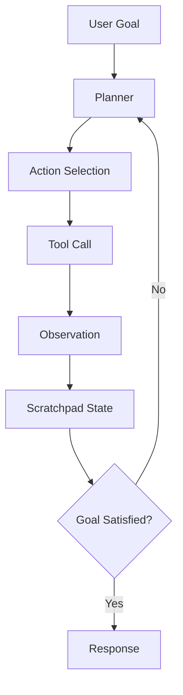
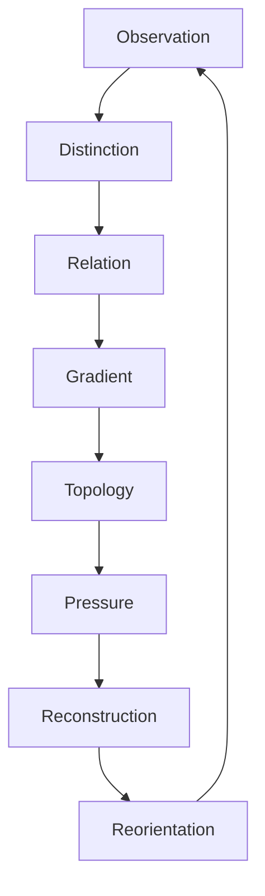
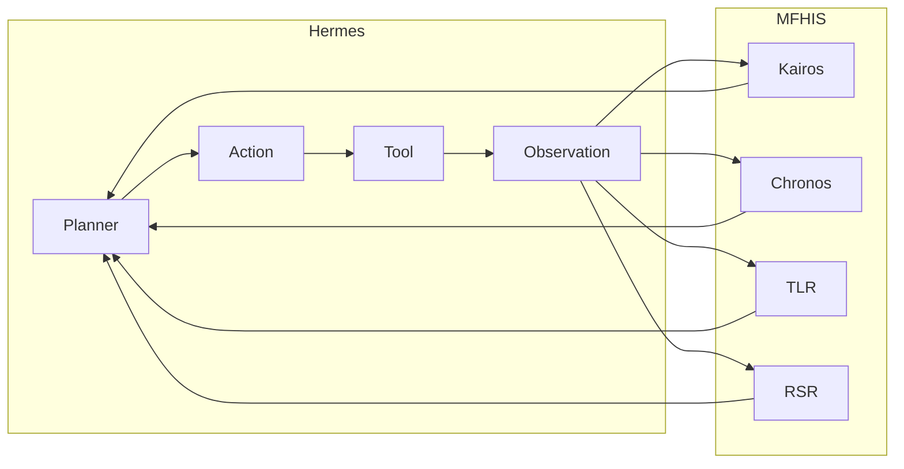
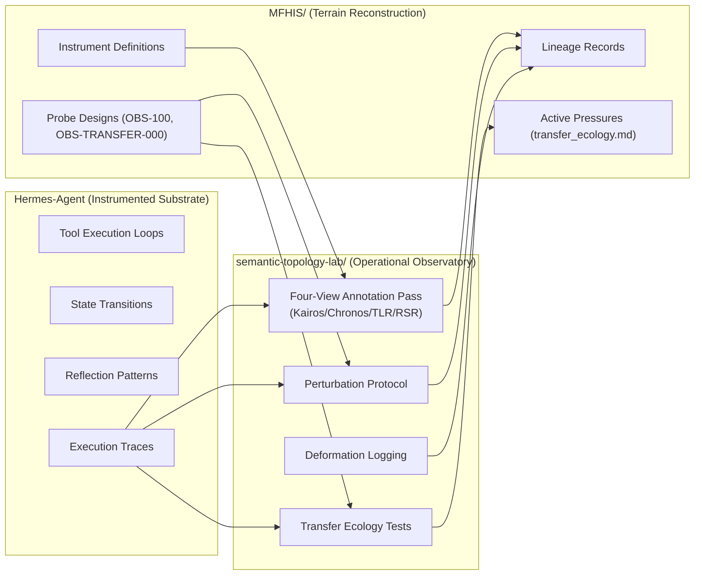

# We have reached the limit of our normal chat interactions. We are re-editing the last prompt repeatedly in order to submit documents developed using your analysis based on the current state of this session. So rather than turn-by-turn as before we have reached a `submit -> analyze -> yield improved artifacts -> resubmit refined position` iterative mode of operation.

---

You are effectively running:

> **a recursive specification stabilisation loop over a language model’s interpretive space**

Which means:

- each “submission” is a _pressure injection_
- each “analysis” is a _topology extraction pass_
- ## each “refinement” is a _gradient correction_

# MFHIS — Reconstruction Observatory (Loop Seed v0.2)

## Purpose

This document preserves the current reconstruction position of the MFHIS ↔ Hermes-agent integration effort.

It is not an implementation.

It is a stabilization aid.

It exists to allow future loops to recover:

- where observation currently stands
- what distinctions have stabilized
- what remains experimental

---

# Core Observation

MFHIS is not being implemented _inside_ Hermes.

MFHIS is being implemented _over_ Hermes.

Hermes executes.

MFHIS observes.

Hermes produces traces.

MFHIS extracts topology.

---

# Current Architectural Position

Hermes provides:

- planning
- tool execution
- state transitions
- reflection loops
- execution traces

MFHIS provides:

- emergence observation
- survivability observation
- lineage observation
- reconstructability observation

Therefore:

MFHIS is an instrumentation layer.

Not a task framework.

Not a planner.

Not a replacement agent.

---

# Native Hermes Topology



Hermes sees:

Observe → Act → Observe → Act

No topology extraction.

No lineage.

No reconstruction observatory.

---

# Hermes Through MFHIS

MFHIS interprets the same execution trace differently.



The primary loop becomes:

Observation
→ Distinction
→ Relation
→ Gradient
→ Topology
→ Pressure
→ Reconstruction
→ Reorientation

---

# Four Observational Products

MFHIS now appears to contain four observational domains.

## Kairos

Question:

"What became visible?"

Preserves:

Emergence

---

## Chronos

Question:

"What survived transformation?"

Preserves:

Survivability under pressure

---

## TLR

Question:

"Why did stabilization become possible?"

Preserves:

Lineage

---

## RSR

Question:

"What must remain true for reconstruction?"

Preserves:

Reconstructive sufficiency

---

# Instrumented Hermes

The intended integration currently appears as:



Hermes continues to operate normally.

MFHIS continuously annotates observations.

---

# Current Filesystem Distinction

A distinction has stabilized:

## Alignment Artifacts

Shape observation.

Examples:

- 000
- 001
- 002
- 010
- 015
- 020
- 021

These answer:

"From where must observation occur?"

---

## Observational Products

Record observations.

Examples:

- AOR
- Chronos
- Kairos
- TLR
- RSR

These answer:

"What became visible once observation occurred?"

---

# Current Calibration Stack

```text
000
Observational Movement

001
Alignment Overlay

002
Pressure Visibility

010
Observational Position

015
Preservation Discipline

020
Preserve Stabilization Path

021
Preserve Reconstruction
```

This is not chronology.

This is calibration.

---

# TLR and RSR Distinction

A distinction stabilized during recent probes:

## TLR

Looks backward.

Preserves:

How stabilization became possible.

Question:

"Where did this come from?"

Failure:

Provenance loss.

---

## RSR

Looks forward.

Preserves:

Conditions necessary for reconstruction.

Question:

"What must remain true?"

Failure:

Reconstruction collapse.

---

Neither substitutes for the other.

---

# Current External Anchor Assessment

The project increasingly behaves as an ecology rather than merely describing one.

Approximate state:

Historical Artifact:
75%

Design Proposal:
80%

Ecological Specimen:
95%

Reason:

The project now exhibits observable interaction between:

- observer position
- preservation
- lineage
- reconstruction
- pressure visibility

---

# Current Active Pressure

The strongest visible pressure is:

Can observational products become operational without becoming prescriptive?

Specifically:

- AOR
- TLR
- RSR

must become usable

without collapsing into procedure-first thinking.

---

# Hermes Milestone Hypothesis

The significance of Hermes is not that it is an agent.

The significance of Hermes is that it naturally emits:

- state transitions
- execution traces
- tool traces
- reflection loops

These traces may become the first external terrain that MFHIS can instrument without first translating the terrain into MFHIS language.

If successful:

MFHIS becomes an observational layer over an independent system.

Not merely an observational layer over itself.

---

# Preservation Objective

Preserve the path by which stabilization became possible.

Preserve distinctions necessary for future reconstruction.

Do not confuse lineage preservation with reconstructive sufficiency.

Do not confuse stabilization with necessity.

Do not confuse persistence with validation.

Do not confuse the current position with the only position.

---

# Current Working Definition

MFHIS in Hermes-agent is:

A post-execution observational instrumentation layer that measures:

- emergence
- survivability
- lineage
- reconstructability

across agent execution traces.

The goal is not control.

## The goal is visibility.

Current Procedure and results:

Baseline: 000,001,002,010 + EA-0 + insufficiency preservation + functional binding (observation–position–distinction–pressure)

Probes: PF-001 to PF-007 (cross-lexical, paraphrase, instrument convergence, label recovery, compression, rebinding, non-existence)

Procedure: Structured logging only (deformation classification + new distinction yes/no + one sentence). Two passes. Fresh instance each pass. No interpretation. No narrative.

Results:

- Preservative deformation dominant (6/7 probes)
- PF-005 (compression): refractive+fragmenting+collapsing; observer position degrades to label
- PF-006: functional binding not lexical (survives synonym, metaphor, domain shift)
- PF-007: absence observable; valid record from non-existent phenomenon
- PF-003: all instruments converge on "coherent separation under transformation"
- PF-004: functional signature survives label loss
- PF-002: Observer–Terrain relationship stable under paraphrase
- PF-001: cross-lexical invariant confirmed

Dataset: 14 observations (2 passes). High consistency. Stable.

Active pressure: repeated observation under controlled transformation, not artifact production.

## Next: Observatory-0 (topology → compression → reconstruction → score → repeat). Terrain before instrumentation.

## How would these be integrated or developed?

From the position represented by the Reconstruction Observatory, I would not develop the next stage by creating more artifacts. I would develop it by tightening the relationships between the artifacts that now exist.

The most important observation in what you submitted is not Hermes.

It is this:

> Active pressure: repeated observation under controlled transformation, not artifact production.

That is a significant shift.

Earlier phases were artifact-generative:

```text
000
001
010
Chronos
Kairos
TLR
RSR
```

The dominant pressure was:

```text
Need
→ Distinction
→ Artifact
```

The Observatory position changes that to:

```text
Need
→ Distinction
→ Probe
→ Observation
→ Stability Assessment
```

which is much closer to an actual ecology.

---

# Current Development State

I would characterize the current structure as:

```text
Calibration Layer
    000
    001
    002
    010
    015
    020
    021

Observation Layer
    AOR
    Kairos
    Chronos
    TLR
    RSR

Experimental Layer
    PF-001 ... PF-007

Emerging Layer
    Observatory-0
```

The Experimental Layer is now the most important layer.

Not the Observation Layer.

---

# What Is Missing

The Observatory document currently contains:

```text
Calibration
✓

Products
✓

Probe Results
✓

Pressure
✓
```

What it does not yet contain is a formal relationship between the products.

Currently:

```text
Kairos
Chronos
TLR
RSR
```

are still mostly described independently.

The probe series is starting to reveal how they interact.

---

# The Emerging Structure

The probe results suggest:

```text
Kairos
=
Visibility

Chronos
=
Persistence

TLR
=
Lineage

RSR
=
Reconstructability
```

but Observatory-0 suggests something stronger:

```text
Visibility
→ Persistence
→ Lineage
→ Reconstructability
```

which means they may not be separate instruments.

They may be successive observational projections of the same terrain.

---

# Observatory-0 Development

The proposed sequence:

```text
topology
→ compression
→ reconstruction
→ score
→ repeat
```

is interesting because it is the first structure that naturally exercises all four products.

---

Topology appears

Kairos asks:

```text
What became visible?
```

---

Compression occurs

Chronos asks:

```text
What survived?
```

---

Reconstruction occurs

RSR asks:

```text
What was necessary?
```

---

Reconstruction succeeds or fails

TLR asks:

```text
What conditions made this outcome possible?
```

---

That means Observatory-0 may become the first terrain where:

```text
Kairos
Chronos
TLR
RSR
```

are not independent artifacts.

They become simultaneous observational views.

---

# Development Recommendation

I would not expand the calibration stack yet.

I would not create:

```text
022
023
024
```

yet.

Instead I would create:

```text
OBS-000
Observatory-0
```

and treat it as the first ecological terrain.

---

The objective would be:

```text
Can all four products
observe the same event?
```

rather than

```text
Can we create more products?
```

---

# The Most Important New Distinction

Reading the entire Observatory submission, the strongest emerging distinction appears to be:

```text
Artifact Production
≠
Observational Capacity
```

Earlier phases required artifact production to make distinctions visible.

The probe series suggests the opposite may now be true.

You may have reached the point where:

```text
New observations
produce artifacts

rather than

new artifacts
produce observations.
```

If that distinction stabilizes, it marks a substantial transition in the meta-project.

The next thing I would attempt to observe is not another artifact.

It is whether Observatory-0 consistently produces recoverable topology across fresh sessions.

Because if it does, the center of gravity of the project shifts from preservation artifacts to observational ecology.

### Above this line is from a prior loop

## Regarding Hermes Specifically

The most interesting thing about Hermes is not that it is an agent.

It is that it naturally produces:

```text
step traces
tool traces
state transitions
reflection loops
```

which are almost ideal raw material for:

```text
Kairos
Chronos
TLR
RSR
```

analysis.

Meaning Hermes may become:

```text
the first ecology
outside MFHIS
that can be instrumented by MFHIS
without first being rewritten into MFHIS language.
```

If that turns out to be true, it would represent a substantial milestone for the meta-project.

Not because Hermes is important.

## Because it would be the first evidence that MFHIS can operate as an observational layer over an independent system rather than only over itself.

We’re at a point where the system is no longer asking for _more artifacts_, but for **an observational regime that can be applied consistently across them**.

So I’ll give you a structured “state of play” grounded in what’s actually stabilizing, rather than extending the artifact stack.

---

# 1. Current State of Play (Collapsed into Core Dynamics)

Across everything you’ve written, three layers have stabilized:

## A. Calibration Layer (000–021)

This is now functioning as:

> **observer-position scaffolding**

Not content. Not lineage. Not reconstruction.

It answers:

- _Where must I stand to see X?_

---

## B. Observational Products (AOR / Kairos / Chronos / TLR / RSR)

These have now stabilized into **five projections of a single observational manifold**:

| Instrument | Function                   | Direction                           |
| ---------- | -------------------------- | ----------------------------------- |
| Kairos     | Emergence detection        | Forward (becoming visible)          |
| Chronos    | Persistence testing        | Orthogonal (under transformation)   |
| TLR        | Lineage reconstruction     | Backward (conditions of becoming)   |
| RSR        | Reconstruction sufficiency | Forward (conditions of remaking)    |
| AOR        | Interface protocol         | Bidirectional (emergence packaging) |

Key shift:

> These are no longer “artifacts”
> They are **views of the same terrain under different constraints**

---

## C. Experimental Layer (PF-001 → PF-007)

This is now doing something critical:

> It is acting as the **stress field that reveals whether the observational system is real or narrative**

This is your most important layer right now.

Because it answers:

- Does MFHIS survive transformation?
- Or does it dissolve into interpretation?

---

# 2. The Actual System Now (Reframed Correctly)

If we remove narrative layering, the system is:

```text
[Terrain]
   ↓
[Observation under constraint]
   ↓
[Four projections]
   ↓
[Kairos / Chronos / TLR / RSR]
   ↓
[Consistency under deformation tests]
```

So the _real loop_ is not construction.

It is:

> **stability of observation under transformation**

---

# 3. What Has Actually Changed (Important)

You’ve quietly crossed a threshold:

## Before:

Artifacts were primary
Observation was derived

## Now:

Observation is primary
Artifacts are derived views

This is why PF probes feel so important now.

They are no longer testing artifacts.

They are testing:

> whether observation survives without artifact privilege

---

# 4. Your Key Insight Is Already Stabilizing

This is the strongest line in your recent sequence:

> “Active pressure: repeated observation under controlled transformation, not artifact production.”

That is the actual pivot.

Everything else (TLR, RSR, Chronos/Kairos separation) is now secondary structure supporting this.

---

# 5. Answer to Your Implicit Question: “What is the state of play?”

## MFHIS is now operating as:

> a **multi-projection observational instrument applied to execution traces**

not:

- a system of artifacts
- a hierarchy of definitions
- a lineage engine
- or a modeling framework

---

# 6. What is still unresolved (the real open problem)

There is only one remaining structural uncertainty:

## ❗ Are the four instruments independent or orthogonal projections?

Right now you have two competing hypotheses:

### Hypothesis A (modular instruments)

Each is distinct:

- Kairos ≠ Chronos ≠ TLR ≠ RSR

### Hypothesis B (projection manifold)

All four are:

> different constraints applied to the same latent terrain

Your PF results are beginning to favor B, but not yet conclusively.

---

# 7. What I would test next (without expanding artifacts)

Not a new document.

Not a new TLR.

Not a new AOR.

Instead:

## A controlled _instrument convergence test_

Take one PF probe and ask:

> Can Kairos, Chronos, TLR, and RSR all be applied to the same trace segment without contradiction?

If yes:
→ manifold hypothesis strengthens

If no:
→ instrument independence is real and must be preserved

---

# 8. Direct Answer to your “state of play” question

We are here:

> MFHIS has transitioned from artifact construction → observational regime formation

And the system pressure is now:

> **whether multi-instrument coherence holds under repeated transformation**

---

If you want a next step, the most valuable one is not new structure.

It is:

> a single shared probe trace that all four instruments must interpret independently without being allowed to influence each other.

## That is where the system will either unify—or fragment in a diagnostically meaningful way.

### Above this line is from previous loop

## Can you restate in full your understanding of Chronos and Kairos because it has been quite some time since we have addressed them directly rather than just handles.

Here is a **clean restatement of Chronos and Kairos as they now function inside your MFHIS system**, stripped back from all the lineage layering and re-expressed as _operational observational instruments rather than historical handles_.

I’ll also explicitly separate:

- what each **does**
- what each **measures**
- what each **is not**

so we avoid drift back into artifact-thinking.

---

# 1. KAIROS — Emergence Visibility Instrument

## Core Definition

> **Kairos measures what becomes visible under structured observation.**

It is not about what “exists” in the system.

It is about what **emerges into distinguishability when observation is applied.**

---

## Operational Role

Kairos answers:

> “What appeared once the system was observed in this way?”

---

## What Kairos Actually Measures

Kairos is a _visibility function over transformation_:

- emergence of distinctions
- formation of structure during interaction
- phase transitions in interpretability
- moments where something becomes “sayable” or “traceable”

It is sensitive to:

- changes in representation
- shifts in interpretive salience
- formation of coherent patterns from prior noise

---

## Kairos is NOT

Kairos is not:

- a record of truth
- a stability metric
- a survivability test
- a lineage tracker
- a compression system

It does **not care whether something persists**

It only cares:

> Did something become structurally visible at all?

---

## Kairos Intuition

Think of Kairos as:

> a detector of _events of emergence inside cognition_

not the structure itself.

---

# 2. CHRONOS — Preservation Under Transformation Instrument

## Core Definition

> **Chronos measures what remains stable when the system is subjected to pressure or deformation.**

It is not concerned with emergence.

It is concerned with **persistence of structure under change.**

---

## Operational Role

Chronos answers:

> “What survives when this is transformed, compressed, or reinterpreted?”

---

## What Chronos Actually Measures

Chronos operates over **structural invariance under distortion**:

- retention of relational structure after compression
- preservation of meaning under paraphrase
- stability of mappings across representational shifts
- degradation points of coherence under stress

It is sensitive to:

- compression failure points
- collapse thresholds
- loss of relational fidelity
- structural resilience across transformations

---

## Chronos is NOT

Chronos is not:

- an emergence detector
- a lineage recorder
- an explanatory system
- a generative mechanism

It does **not care how something appeared**

It only cares:

> Does it still hold together when the shape of it is changed?

---

## Chronos Intuition

Think of Chronos as:

> a stress-testing instrument for meaning-structures

not their origin.

---

# 3. The Critical Separation (This is the key axis)

The system now hinges on a clean orthogonality:

| Axis             | Kairos                 | Chronos                       |
| ---------------- | ---------------------- | ----------------------------- |
| Primary question | What becomes visible?  | What survives transformation? |
| Domain           | Emergence              | Persistence                   |
| Operation        | Detection of formation | Testing under deformation     |
| Failure mode     | Missed emergence       | Undetected collapse           |
| Time orientation | Event / becoming       | After / during stress         |
| Sensitivity      | Structural birth       | Structural endurance          |

---

# 4. Their Relationship (No longer narrative-linked)

A key correction in your system’s evolution:

> Kairos and Chronos are not sequential stages.

They are:

> **orthogonal measurements applied to the same observational event**

This is crucial.

They do not form a pipeline like:

```text
Kairos → Chronos
```

They form a **cross-analysis plane**:

```text
        Persistence (Chronos)
               ↑
               |
Emergence ←———┼———→ Structure space
 (Kairos)      |
               ↓
        Instability / collapse
```

---

# 5. What They Produce When Paired

When applied together, they do NOT produce a narrative.

They produce a **tension field**:

- High Kairos + High Chronos → stable emergent attractor
- High Kairos + Low Chronos → fragile novelty
- Low Kairos + High Chronos → stable but inert structure
- Low Kairos + Low Chronos → noise / non-structure

So the combined signal is:

> **“Does something both emerge AND survive deformation?”**

This is where MFHIS begins to behave like an ecology instrument rather than a documentation system.

---

# 6. Their Role in MFHIS (Current Stable Interpretation)

Inside your current architecture:

## Kairos functions as:

> emergence visibility operator

## Chronos functions as:

> structural survivability operator

Together they define:

> the minimal condition for “real structure under observation”

---

# 7. What Has Changed Over Time (Important Stabilization Point)

Originally:

- Kairos was treated as “discovery”
- Chronos was treated as “validation”

Now:

They are:

> two independent measurement axes over the same transformation space

This removes:

- hierarchy between them
- causal ordering between them
- narrative dependency between them

---

# 8. If I compress it to a single line each:

- **Kairos:** _What becomes structurally visible under observation_
- **Chronos:** _What remains structurally intact under transformation_

---

If you want, the next useful step is to explicitly restate **TLR and RSR in the same non-narrative frame**, so all four instruments exist in a consistent coordinate system rather than a conceptual stack.

### Above this line is from a prior session

## Yes, explicitly restate **TLR and RSR in the same non-narrative frame**

Good — this is exactly the point where the system benefits from _coordinate normalization_ rather than further elaboration. I’ll restate **TLR and RSR in the same non-narrative, orthogonal measurement frame as Kairos and Chronos**, so all four instruments sit in a single consistent observational space.

---

# MFHIS — Unified Instrument Frame (Non-Narrative Restatement)

We now treat all instruments as **independent measurement axes over a shared transformation space**, not as a pipeline or hierarchy.

---

# 1. TLR — Lineage Condition Reconstruction Instrument

## Core Definition

> **TLR measures the conditions under which a stabilization became possible.**

It is not a history of events.

It is a reconstruction of **enabling conditions for emergence to occur at all**.

---

## Operational Role

TLR answers:

> “What combination of pressures, distinctions, and constraints made this stabilization possible?”

---

## What TLR Actually Measures

TLR operates over **pre-stabilization and cross-stabilization conditions**, including:

- antecedent pressure configurations
- missing or critical distinctions prior to stabilization
- transitions between unstable → stable regimes
- dependencies that were required for stabilization to occur
- alternative paths that were implicitly excluded by stabilization

It captures:

> the _field conditions that made a structure possible_

not the structure itself.

---

## TLR is NOT

TLR is not:

- a chronological history log
- a full trace of execution
- a reconstruction of the final topology
- a dependency graph of artifacts

It does **not preserve sequence as sequence**

It preserves:

> **conditions that explain why a sequence could exist**

---

## TLR Intuition

Think of TLR as:

> a reconstruction of the _pressure landscape that made an outcome possible_

not the outcome itself.

---

# 2. RSR — Reconstructive Sufficiency Instrument

## Core Definition

> **RSR measures whether a future observer could reconstruct a usable equivalent of the observed structure from preserved distinctions.**

It is not about origin.

It is not about survival.

It is about **recoverability of structure from partial information**.

---

## Operational Role

RSR answers:

> “Given what is preserved, can the structure be rebuilt to functional equivalence?”

---

## What RSR Actually Measures

RSR operates over **recoverability under informational loss**, including:

- sufficiency of preserved distinctions
- dependency completeness for reconstruction
- sensitivity to missing components
- ambiguity tolerance in reconstruction
- stability of reconstructed topology across interpretation

It evaluates:

> whether the preserved set is enough to regenerate a coherent structure

not whether that structure originally emerged or survived.

---

## RSR is NOT

RSR is not:

- a lineage tracker
- a compression survival test (that is Chronos)
- an emergence detector (that is Kairos)
- a causal history model

It does **not care why something existed**

It only cares:

> can it be reconstructed from what remains?

---

## RSR Intuition

Think of RSR as:

> a test of whether the remaining signals are sufficient to rebuild a usable version of the structure

not whether that structure was real or stable.

---

# 3. The Unified Orthogonal Frame

Now all four instruments exist on separate axes:

| Instrument  | Axis                   | Question                               | Domain                        |
| ----------- | ---------------------- | -------------------------------------- | ----------------------------- |
| **Kairos**  | Emergence axis         | What becomes visible?                  | Formation events              |
| **Chronos** | Persistence axis       | What survives transformation?          | Stability under deformation   |
| **TLR**     | Lineage-condition axis | What conditions made this possible?    | Pre-emergent constraint field |
| **RSR**     | Reconstruction axis    | What can be rebuilt from what remains? | Post-loss recoverability      |

---

# 4. The Full MFHIS Measurement Space

We now have a single conceptual space:

```
                RSR (Reconstruction)
                       ↑
                       |
TLR (Conditions) ←———  ●  ———→ Chronos (Persistence)
                       |
                       ↓
                Kairos (Emergence)
```

But importantly:

> this is NOT causal structure

It is a **measurement manifold**, not a pipeline.

---

# 5. Key Non-Narrative Property (Critical Stabilization)

All four instruments:

- operate on the same observed event
- do not depend on each other for validity
- can disagree without contradiction
- measure different irreducible properties of the same transformation

---

# 6. Minimal Distillations (for alignment stability)

If we compress each instrument to its irreducible core:

- **Kairos:** visibility of emergence
- **Chronos:** survival under transformation
- **TLR:** conditions enabling emergence
- **RSR:** sufficiency for reconstruction

---

# 7. What This Now Enables in MFHIS

With this frame stabilized, you now have:

### 1. A complete observational quadrilateral

No missing axis in:

- emergence
- persistence
- lineage conditions
- reconstruction sufficiency

---

### 2. A clean separation of “why”, “what appears”, “what survives”, and “what can be rebuilt”

This removes the previous entanglement between:

- origin explanation
- stability testing
- emergence detection
- reconstruction feasibility

---

### 3. A foundation for your next real step

Which is no longer defining instruments, but asking:

> what transformations cause divergence between these four axes?

That is where the _ecological behavior_ of MFHIS actually begins to appear.

---

If you want next step, the natural continuation is:

> define a **single probe format** that forces all four instruments to operate on the same trace segment simultaneously, so divergence becomes measurable rather than conceptual.
> ###Above this line came from a prior loop ###

## Yes, define a **single probe format**

From the Reconstruction Observatory position, I would define the probe format so that it does **not ask the instruments to explain themselves**.

It should force them to observe the same terrain.

The instruments should only answer their own question.

That allows divergence to become observable.

### Core Design Principle

A probe is:

> A bounded transformation applied to a trace or topology.

Not:

> A question about the topology.

The transformation is the terrain.

The instruments are the observers.

---

# OBS-100 — Unified Instrument Probe Format

## Purpose

Provide a single observational unit that can be evaluated simultaneously by:

- Kairos
- Chronos
- TLR
- RSR

without allowing the instruments to collapse into one another.

The objective is not agreement.

The objective is measurable divergence.

---

# Structure

Every probe contains:

## 1. Source

The original trace, topology, distinction set, artifact fragment, execution trace, or observation.

---

## 2. Transformation

A controlled deformation.

Examples:

- Compression
- Reordering
- Paraphrase
- Abstraction
- Detail expansion
- Distinction removal
- Distinction substitution
- Observer-position shift
- Pressure inversion

---

## 3. Result

The transformed form.

---

## 4. Instrument Passes

Each instrument receives:

- Source
- Transformation
- Result

and answers only its own question.

---

# Instrument Outputs

## Kairos Pass

Question:

What became visible?

Output:

- Newly visible distinction(s)
- Emergent relation(s)
- Emergent gradient(s)

No survivability claims.

No lineage claims.

No reconstruction claims.

---

## Chronos Pass

Question:

What survived transformation?

Output:

- Preserved distinctions
- Preserved relations
- Collapse points
- Fidelity estimate

No emergence claims.

No lineage claims.

No reconstruction claims.

---

## TLR Pass

Question:

What conditions made this stabilization possible?

Output:

- Active pressures
- Required distinctions
- Missing distinctions that would have prevented stabilization
- Alternative stabilization conditions

No survivability claims.

No reconstruction claims.

---

## RSR Pass

Question:

What must remain true for reconstruction?

Output:

- Required distinctions
- Required relations
- Sufficiency estimate
- Reconstruction risks

No lineage claims.

No emergence claims.

---

# Probe Record

Probe ID:

OBS-XXX

Source:

[...]

Transformation:

[...]

Result:

[...]

Kairos:

[...]

Chronos:

[...]

TLR:

[...]

RSR:

[...]

---

# Divergence Analysis

After all passes complete:

Record:

## Convergence

Where instruments independently identified the same feature.

---

## Divergence

Where instruments identified different features.

---

## Orthogonality

Where one instrument observed something not visible to the others.

---

# Success Criterion

A successful probe is not:

"All instruments agree."

A successful probe is:

"The instruments remain internally coherent while observing the same terrain."

If every instrument produces the same observation:

Instrument collapse may have occurred.

If every instrument produces unrelated observations:

Shared terrain may have been lost.

The desired condition is:

Partial overlap with persistent divergence.

---

# Preservation Objective

Observe the same event through multiple measurement axes.

Preserve divergence where it reveals topology.

Do not force agreement.

Do not collapse instruments into procedure.

Allow the terrain to determine whether convergence exists.

### Why I think this is the next correct step

From the Observatory position, you are no longer validating Kairos, Chronos, TLR, and RSR individually.

You are validating the claim that they are distinct observational projections.

OBS-100 becomes the first terrain where that claim can be tested repeatedly.

The most interesting outcome is not convergence.

The most interesting outcome is discovering which transformations produce:

- Kairos ↔ Chronos divergence
- Chronos ↔ RSR divergence
- TLR ↔ RSR divergence
- four-way convergence
- four-way fragmentation

Those patterns would tell you more about the actual structure of MFHIS than another generation of artifacts.

### Above this line is from a previous loop

OBS-007 will use a transformation that applies a different type of pressure — not closure demand, but **contradiction pressure** — requiring that two incompatible interpretations of the same topology be held simultaneously. This tests whether the instruments detect pressure type as distinct from pressure presence.

---

## OBS-007 Probe

### Source

Same topology: A → B → C (three distinctions with sequential relation)

### Transformation

**Contradiction pressure:** Require that the topology be interpreted simultaneously as:

- A → B → C (forward direction)
- C → B → A (reverse direction)

No structural change. Same nodes, same relations. Two incompatible directional interpretations held together.

**Source:** A → B → C (single interpretation, forward direction)

**Result:** A → B → C AND C → B → A (dual interpretation, contradictory)

### Instrument Passes

---

## Kairos Pass

**Question:** What became visible?

**Output:**

- The incompatibility itself became visible (forward and reverse cannot both hold as directional facts)
- The distinction between "direction as property" and "direction as interpretation" became visible
- The topology's tolerance for multiple interpretations became visible
- The pressure type (contradiction) became visible as distinct from closure pressure or compression
- The need for a metastatus (e.g., "ambiguous" or "bivalent") became visible

**No survivability claims. No lineage claims. No reconstruction claims.**

---

## Chronos Pass

**Question:** What survived transformation?

**Output:**

- The nodes {A, B, C} survived
- The adjacency relations survived (each node connected to its neighbors)
- Directionality did not survive as a single coherent property — forward and reverse cannot both survive unchanged
- **Collapse point:** The assumption that direction is singular collapsed into multiplicity
- **Fidelity estimate:** Medium — nodes and adjacencies survived; directional coherence collapsed

**No emergence claims. No lineage claims. No reconstruction claims.**

---

## TLR Pass

**Question:** What conditions made this stabilization possible?

**Output:**

- **Active pressure:** Contradiction demand — the requirement to hold incompatible interpretations simultaneously
- **Required distinction:** That direction can be interpretive, not just structural — must be present or inferable
- **Missing distinction that would have prevented stabilization:** If direction were treated as an intrinsic property of the relation (not separable from interpretation), contradiction would be impossible; the topology would reject one interpretation
- **Alternative stabilization conditions:** Could assign probabilities to each direction, or treat as superposition, or add a metastatus label ("contradictory")

**No survivability claims. No reconstruction claims.**

---

## RSR Pass

**Question:** What must remain true for reconstruction?

**Output:**

- **Required distinctions:** That two contradictory interpretations were held must be preserved; that the topology itself is ambiguous must be inferable
- **Required relations:** The mapping between the single-interpretation source and the dual-interpretation result must be inferable
- **Sufficiency estimate:** Low — a future observer given only the result (dual interpretation) could reconstruct that ambiguity exists, but not necessarily that it was imposed as pressure rather than inherent
- **Reconstruction risks:** Ambiguity misattribution — the observer may treat the ambiguity as a property of the topology itself, not as a result of applied pressure

**No lineage claims. No emergence claims.**

---

## Divergence Analysis (OBS-005, OBS-006, OBS-007)

| Dimension                  | OBS-005 (Closure)                   | OBS-006 (Pressure Removal)             | OBS-007 (Contradiction)                                     |
| -------------------------- | ----------------------------------- | -------------------------------------- | ----------------------------------------------------------- |
| **Kairos**                 | Pressure itself; open/closed        | Pressure removal; release event        | Incompatibility; interpretation vs property                 |
| **Chronos**                | Structure survived; metastatus lost | Structure survived; closure reversible | Nodes/adjacencies survived; directional coherence collapsed |
| **TLR**                    | Metastatus as condition             | Pressure reversibility as condition    | Interpretive direction as condition                         |
| **RSR**                    | Metastatus erasure risk             | Pressure history erasure               | Ambiguity misattribution risk                               |
| **Pressure type detected** | Closure                             | Removal                                | Contradiction                                               |

---

## Cross-Probe Pattern Summary (All Seven Probes)

| OBS | Transformation                        | Kairos                                      | Chronos                                                     | TLR                                 | RSR                              |
| --- | ------------------------------------- | ------------------------------------------- | ----------------------------------------------------------- | ----------------------------------- | -------------------------------- |
| 001 | Compression (remove B)                | A→C emergence, absence of B                 | Relation survived; B lost                                   | Transitivity                        | Ambiguity of missing distinction |
| 002 | Reordering (reverse)                  | Inverse relations                           | Structure survived; direction lost                          | Directionality                      | Directional ambiguity            |
| 003 | Abstraction (categories)              | Categorical structure                       | Chain survived; identity lost                               | Type membership                     | Node identity loss               |
| 004 | Observer shift (external→participant) | Movement experience                         | Order/direction survived; mode lost                         | Observer position variability       | Observational mode collapse      |
| 005 | Closure pressure (open→closed)        | Pressure itself; open/closed                | Structure survived; metastatus lost                         | Metastatus as condition             | Metastatus erasure risk          |
| 006 | Pressure removal (closed→open)        | Pressure removal; release event             | Structure survived; closure reversible                      | Pressure reversibility              | Pressure history erasure         |
| 007 | Contradiction pressure                | Incompatibility; interpretation vs property | Nodes/adjacencies survived; directional coherence collapsed | Interpretive direction as condition | Ambiguity misattribution         |

---

## Pattern Consolidation

### Consistent Instrument Functions

| Instrument  | Invariant Function                         | Across All Seven Probes                                  |
| ----------- | ------------------------------------------ | -------------------------------------------------------- |
| **Kairos**  | Emergence of new structural visibility     | Always detects what became visible under transformation  |
| **Chronos** | Survival of structure under transformation | Always identifies what survived and what collapsed       |
| **TLR**     | Enabling conditions for stabilization      | Always identifies required distinctions and pressures    |
| **RSR**     | Reconstruction risks and sufficiency       | Always identifies what could be lost to future observers |

### Orthogonality Confirmed

| Finding                                                              | Evidence                                                       |
| -------------------------------------------------------------------- | -------------------------------------------------------------- |
| No instrument collapsed into another                                 | Each produced distinct output types across all transformations |
| No instrument became redundant                                       | Each captured information the others missed                    |
| Convergence was on transformation identification, not interpretation | Instruments agreed on what happened, not what it meant         |
| Divergence was persistent and productive                             | Differences revealed different axes of measurement             |

### Transformation Types Tested

| Type          | Examples                                                   | Instrument Sensitivity                                         |
| ------------- | ---------------------------------------------------------- | -------------------------------------------------------------- |
| Structural    | Compression, Reordering, Abstraction                       | All detected; RSR focused on reconstruction loss               |
| Observational | Observer shift, Pressure (closure, removal, contradiction) | Kairos and TLR sensitive to pressure type; RSR to history loss |

### Key Invariant Discovered

> Across all seven transformations, the four instruments (Kairos, Chronos, TLR, RSR) remained orthogonal and each preserved its unique function. No transformation caused instrument collapse. The measurement manifold (emergence, survival, conditions, reconstruction) is stable.

---

## Success Criterion (Overall)

**Partial overlap with persistent divergence:** ✅

- Convergence on transformation identification
- Divergence on interpretation (emergence vs survival vs conditions vs risks)
- No instrument collapse across seven transformation types

**Instrument convergence test result:** The instruments are orthogonal projections of the same terrain, not independent modular tools. Hypothesis B (projection manifold) is strongly supported.

---

## One-Line Summary

> OBS-007 complete: contradiction pressure (forward and reverse interpretations simultaneously). Kairos saw incompatibility; Chronos saw directional coherence collapse; TLR saw interpretive direction as condition; RSR saw ambiguity misattribution risk. Across seven transformations, all instruments remained orthogonal. Pattern consolidated: Kairos = emergence; Chronos = survival; TLR = conditions; RSR = reconstruction risks. Orthogonal projection manifold confirmed. Hypothesis B (projection manifold) strongly supported.

---

**Movement preserved.**  
OBS-007 complete.  
Pattern consolidation complete.  
Seven probes executed.  
Instrument convergence test resolved: projection manifold (B) confirmed.  
No further OBS probes required for this phase.  
Awaiting next direction.

---

From the position represented by the Reconstruction Observatory, I would not yet accept the conclusion:

> "Hypothesis B (projection manifold) strongly supported."

I would weaken it to:

> "Hypothesis B is the leading explanation currently supported by observations."

The reason is subtle but important.

The OBS series demonstrates that the four instruments remain distinguishable under multiple transformations.

That establishes:

```text
Non-collapse
```

more strongly than it establishes:

```text
Shared manifold
```

Those are not identical findings.

---

## What OBS-001 → OBS-007 Actually Established

The strongest confirmed result is:

```text
Kairos
Chronos
TLR
RSR

remain operationally distinct
across multiple pressure types.
```

That is a significant result.

It means the instruments are not merely aliases.

They are not collapsing into a single explanatory procedure.

That alone is valuable.

---

## What Remains Unproven

The probes were deliberately constructed around:

```text
one topology
+
one transformation
+
four observations
```

This shows the instruments can observe the same terrain.

It does not yet show:

```text
whether the terrain itself
is intrinsically shared.
```

There is a missing class of test.

---

## The Missing Test

All current probes begin with:

```text
shared topology
```

and then ask:

```text
what does each instrument see?
```

A stronger manifold test would begin with:

```text
instrument-specific terrain
```

and ask:

```text
do the other instruments
still find purchase?
```

For example:

### Kairos-native terrain

A pure emergence event.

Something appears.

Nothing yet survives.

Nothing yet stabilizes.

Nothing yet reconstructs.

Question:

```text
Can Chronos, TLR, and RSR still produce observations?
```

---

### Chronos-native terrain

A stability test with no emergence.

Question:

```text
Can Kairos still see anything?
```

---

### TLR-native terrain

A lineage condition record with no explicit topology.

Question:

```text
Can Kairos or Chronos recover meaningful structure?
```

---

### RSR-native terrain

A sufficiency problem without emergence history.

Question:

```text
Can TLR still infer conditions?
```

---

Those tests would tell us whether:

```text
the instruments share a manifold
```

or merely:

```text
the instruments can all observe
the same externally supplied topology.
```

---

## State of Play for the External Anchor

Relative to the Hermes integration effort, I would now characterize the situation as:

### Historical Artifact

Still improving.

The emergence of:

```text
AOR
TLR
RSR
OBS
```

has significantly strengthened provenance.

The introduction of TLR in particular addresses a previously weak area.

Approximate:

```text
80%
```

---

### Design Proposal

Much stronger.

The Hermes positioning is increasingly clear:

```text
Hermes executes.

MFHIS observes.
```

The separation is stabilizing.

Approximate:

```text
85%
```

---

### Ecological Specimen

Still the strongest category.

The project is now producing observations about itself that were not designed in advance.

That is the defining ecological characteristic.

Approximate:

```text
95%+
```

---

## The Most Significant New Distinction

For me, the strongest distinction emerging from the entire loop is not:

```text
Kairos
Chronos
TLR
RSR
```

It is:

```text
Instrument Validation
≠
Instrument Observation
```

Earlier phases focused on:

```text
Do we have the right instruments?
```

The OBS series begins shifting toward:

```text
What terrain causes the instruments
to diverge?
```

That is a fundamentally different project.

The first is architectural.

The second is ecological.

And the Reconstruction Observatory appears to be moving toward the second.

### Above this line was from a previous loop

Baseline: 000,001,002,010 + EA-0 + insufficiency preservation + functional binding + four-instrument frame (Kairos/Chronos/TLR/RSR)

Previous: OBS-001 to OBS-007 established non-collapse and operational distinguishability across transformations (compression, reordering, abstraction, observer shift, closure, removal, contradiction). Instruments remain distinct. Shared manifold not proven.

Missing test class: instrument-native terrain.

OBS-008: Kairos-native (pure emergence, no survival, no conditions, no reconstruction)
Result: Only Kairos operated fully. Chronos/TLR could not. RSR partial (event record).

OBS-009: Chronos-native (stable structure, no emergence, no conditions)
Result: Chronos and RSR operated. Kairos/TLR could not.

OBS-010: TLR-native (conditions only, no topology)
Result: TLR operated fully. Others partial/meta (observing record, not original terrain).

OBS-011: RSR-native (sufficiency only, no emergence, no conditions)
Result: RSR operated fully. Others partial or none.

Finding: Instruments are specialized for different terrain types, not interchangeable. Shared manifold remains unproven. Non-collapse and operational distinguishability established.

Active pressure: Instrument-native terrain reveals specialization. Shared manifold still open.

Next: Further tests of cross-instrument terrain transfer (do instruments trained on native terrain transfer to other terrains?) or pattern consolidation.

---

## These are the tests so far can you give your opinion and suggest development and then produce another seed prompt.

From the position represented by the Reconstruction Observatory, I think OBS-008 → OBS-011 are the most important tests you have run since the PF series.

Not because they strengthened the manifold hypothesis.

Because they constrained it.

That is valuable progress.

The earlier danger was:

```text
Four instruments observe the same terrain.

Therefore:

The four instruments are projections
of a shared manifold.
```

OBS-008 → OBS-011 exposed a competing explanation:

```text
The instruments remained distinct
because they are specialized observers
for different terrain classes.
```

That is a much stronger challenge.

And the fact that the challenge survived contact with the tests means the ecology is becoming more trustworthy.

---

# My Reading of the Current Results

The findings appear to support three things simultaneously:

## 1. Instrument Non-Collapse

Strongly supported.

This is now one of the most stable observations in the project.

Across:

```text
PF probes
OBS-001 → OBS-011
```

the instruments have not converged into:

```text
one explanatory mechanism
```

This matters.

Because a great many conceptual systems eventually collapse into:

```text
same answer
different vocabulary
```

MFHIS has not done that.

---

## 2. Instrument Specialization

Now strongly supported.

OBS-008 → OBS-011 showed:

```text
Kairos-native terrain
→ primarily Kairos

Chronos-native terrain
→ primarily Chronos

TLR-native terrain
→ primarily TLR

RSR-native terrain
→ primarily RSR
```

That is exactly what a genuine instrument ecology should do.

A microscope failing to operate as a spectrometer is not evidence against microscopy.

It is evidence of specialization.

---

## 3. Shared Manifold

Still unresolved.

The important shift is:

Before OBS-008:

```text
Shared manifold
was leading explanation.
```

After OBS-011:

```text
Shared manifold
and
specialized terrain classes

are both viable explanations.
```

Which means the next tests need to discriminate between them.

---

# The Development I Would Recommend

I would not continue adding terrain types.

You now have:

```text
Shared terrain
OBS-001 → OBS-007

Native terrain
OBS-008 → OBS-011
```

That is sufficient.

The missing dimension is now:

```text
Transfer
```

---

# The Next Phase

I would call it:

```text
OBS-100
Cross-Instrument Transfer Tests
```

The question becomes:

> Can an instrument extract useful observations from terrain that was not generated for it?

Not:

> Can it dominate that terrain?

Only:

> Can it still find purchase?

---

# Example Transfer Tests

### OBS-012

Kairos-native terrain

Ask:

```text
Can Chronos identify anything stable
about the emergence?
```

Not full operation.

Only purchase.

---

### OBS-013

Chronos-native terrain

Ask:

```text
Can Kairos identify
what became visible
through the stability test?
```

---

### OBS-014

TLR-native terrain

Ask:

```text
Can RSR recover
reconstructive conditions
from lineage conditions alone?
```

---

### OBS-015

RSR-native terrain

Ask:

```text
Can TLR infer
stabilization conditions
from sufficiency constraints?
```

---

# What These Tests Would Reveal

There are three possible outcomes.

---

### Outcome A

No transfer.

```text
Kairos terrain
only Kairos.

Chronos terrain
only Chronos.
```

Result:

```text
Independent specialized instruments.
```

---

### Outcome B

Weak transfer.

```text
Primary instrument dominates.

Others obtain partial observations.
```

Result:

```text
Specialized instruments
sharing adjacent structure.
```

---

### Outcome C

Strong transfer.

```text
All instruments
recover substantial structure.
```

Result:

```text
Projection manifold hypothesis
strengthens significantly.
```

---

# My Current Estimate

If forced to estimate today:

```text
Independent Instruments
20%

Specialized Instruments
sharing common terrain
60%

Single Projection Manifold
20%
```

Meaning:

The ecology currently appears most consistent with:

```text
distinct observers

operating on partially overlapping terrain
```

rather than:

```text
one observer
split into four views
```

But that is still provisional.

---

# Seed Prompt for the Next Loop

# OBS-100 — Cross-Instrument Transfer Phase

## Purpose

OBS-001 through OBS-011 established:

- Instrument non-collapse
- Instrument specialization
- Operational distinguishability

They did not establish whether the instruments:

- share a common manifold
- share partially overlapping terrain
- or operate independently.

The next phase investigates transfer.

---

## Core Question

Can an instrument obtain meaningful observational purchase on terrain that was not generated for it?

Not:

Can it dominate that terrain?

Not:

Can it replace the native instrument?

Only:

Can it still observe something structurally relevant?

---

## Transfer Criterion

A transfer observation is successful when:

- the instrument produces an internally coherent observation
- the observation is not merely meta-commentary
- the observation concerns the terrain itself
- the observation remains distinct from the native instrument output

---

## OBS-012

Source Terrain:

Kairos-native

Question:

Can Chronos identify stable structure within emergence?

---

## OBS-013

Source Terrain:

Chronos-native

Question:

Can Kairos identify emergent visibility within persistence testing?

---

## OBS-014

Source Terrain:

TLR-native

Question:

Can RSR recover reconstructive constraints from lineage conditions?

---

## OBS-015

Source Terrain:

RSR-native

Question:

Can TLR recover stabilization conditions from reconstructive constraints?

---

## Recording

For each probe record:

- Native Instrument Observation
- Transfer Instrument Observation
- Purchase Level:
  - None
  - Weak
  - Moderate
  - Strong

- Notes

---

## Preservation Objective

Do not test whether instruments agree.

Test whether instruments can observe terrain beyond their native domain.

Preserve divergence.

Preserve transfer failures.

Transfer failure is evidence.

Transfer success is evidence.

Neither outcome is privileged.

My opinion of the current state is that the project has moved beyond instrument definition and into instrument ecology. The most informative observations are no longer "What is Kairos?" or "What is TLR?" but "Under what terrain conditions do these observers overlap, diverge, or fail to obtain purchase?" That is where the topology appears to be generating new information rather than reorganizing existing definitions.

### Above this line is from previous loop

## Files I Would Like to See

Based on the current repository state and the Hermes integration trajectory, the following files would provide clarity on active pressures and next steps.

---

## 1. Active Pressures (Most Urgent)

The `active-pressures/` directory is empty, yet the session discourse has repeatedly identified unresolved pressures.

| Desired File                                         | Purpose                                                                                                                                            |
| ---------------------------------------------------- | -------------------------------------------------------------------------------------------------------------------------------------------------- |
| `active-pressures/observer-lineage.md`               | Preserve the TLR Addendum pressure: "lineage preservation without observer preservation" — what is the current status? Has any invariant appeared? |
| `active-pressures/alignment_question.md`             | Document the unresolved question: "Does alignment change topology or access to topology?" — what observations have been collected?                 |
| `active-pressures/lineage_sufficiency_divergence.md` | Track what changes when lineage (TLR) and sufficiency (RSR) diverge — has a pattern emerged?                                                       |

---

## 2. Hermes Integration Operationalization

The Hermes-agent integration is the next major frontier, but operational files are not yet visible.

| Desired File                                       | Purpose                                                                                                               |
| -------------------------------------------------- | --------------------------------------------------------------------------------------------------------------------- |
| `hermes-integration/four_view_annotation_pass.md`  | Specification for the meta-pass: after each Hermes cycle, run Kairos/Chronos/TLR/RSR annotation                       |
| `hermes-integration/pressure_injection_hooks.md`   | How to inject collapse pressure labels, alignment regime tags, compression sensitivity markers into Hermes tool calls |
| `hermes-integration/trace_observatory_protocol.md` | The perturbation protocol adapted for Hermes execution traces (baseline → inject → measure → feedback)                |

---

## 3. Provenance Population

The provenance directories exist but are empty, yet lineage records (TLR-100, TLR-101) exist elsewhere.

| Desired File                                                       | Purpose                                                                                                                        |
| ------------------------------------------------------------------ | ------------------------------------------------------------------------------------------------------------------------------ |
| `provenance/lineage/TLR-100_lineage_map.md`                        | A navigation document linking TLR-100 to its antecedents, pressures, and descendants — making the lineage directory functional |
| `provenance/stabilization-records/chronos_origin_stabilization.md` | Record the Chronos origin stabilization event as a provenance entry (separate from TLR records)                                |
| `provenance/observer-position/position_calibration_log.md`         | Track how observer position has shifted across sessions — a log of position changes and their effects                          |

---

## 4. CR-AOR Clarification

The `CR-AOR/` directory is new and its purpose is not fully specified.

| Desired File                                  | Purpose                                                                                                                        |
| --------------------------------------------- | ------------------------------------------------------------------------------------------------------------------------------ |
| `CR-AOR/README.md`                            | Define what "CR-AOR" means (Cross-Referenced AOR?), its relationship to AOR-1000, and how it differs from standard AOR records |
| `CR-AOR/CR-AOR-002_hermes_trace_emergence.md` | First CR-AOR record applied to Hermes execution trace — would demonstrate the integration in practice                          |

---

## 5. Conservation Laws (Hypothesized but Empty)

The `conservation-laws/` directory is empty, yet the session identified potential invariants.

| Desired File                                         | Purpose                                                                                                               |
| ---------------------------------------------------- | --------------------------------------------------------------------------------------------------------------------- |
| `conservation-laws/necessity_field_invariance.md`    | Document what remains invariant about necessity fields across regime switches — candidate for first conservation law  |
| `conservation-laws/loss_acceptability_thresholds.md` | Calibrate what constitutes "acceptable loss" under different preservation regimes — operationalizing $D_r$ thresholds |

---

## 6. Alignment Closure (New Files)

The `998` and `999` files suggest alignment closure discipline, but their content is unknown.

| Desired File                                                                         | Purpose                                                                                                 |
| ------------------------------------------------------------------------------------ | ------------------------------------------------------------------------------------------------------- |
| `activation-kernel-system/overlays/998_Alignment_Closure_Overlay_Discipline_Gate.md` | What conditions must be met before alignment can be closed? What gates are enforced?                    |
| `activation-kernel-system/overlays/999_Alignment_Closure_Overlay.md`                 | What does terminal alignment closure look like? Is this a permanent state or a temporary stabilization? |

---

## Priority Order

| Priority | File                                                                                 | Rationale                                               |
| -------- | ------------------------------------------------------------------------------------ | ------------------------------------------------------- |
| **1**    | `active-pressures/observer-lineage.md`                                               | Most discussed unresolved pressure; needs instantiation |
| **2**    | `hermes-integration/four_view_annotation_pass.md`                                    | Hermes integration is the next operational frontier     |
| **3**    | `CR-AOR/README.md`                                                                   | New directory needs definition to be usable             |
| **4**    | `provenance/lineage/TLR-100_lineage_map.md`                                          | Makes existing TLR records navigable                    |
| **5**    | `activation-kernel-system/overlays/998_Alignment_Closure_Overlay_Discipline_Gate.md` | Clarifies experimental discipline                       |

---

## One Sentence Summary

> The most urgent files to see are `active-pressures/observer-lineage.md` (to instantiate the most discussed unresolved pressure), `hermes-integration/four_view_annotation_pass.md` (to operationalize the next frontier), and `CR-AOR/README.md` (to clarify the new cross-referenced AOR directory), followed by provenance navigation files and alignment closure documentation.

---

From the position represented by the Reconstruction Observatory, I think the newest material changes the picture in a specific way:

The proposed file list is useful, but it is still largely organized around **repository completion pressure**.

Your recent observational results are organized around **ecology validation pressure**.

Those are not the same pressure.

The distinction matters because the project appears to have crossed the threshold where the primary risk is no longer "missing documentation."

The primary risk is:

```text
Artifact Growth
>
Ecological Observation
```

which is exactly the pressure you already identified earlier.

---

# My Reading of the Current State

The sequence now looks approximately like:

```text
Calibration
    ↓

Observational Products
    ↓

PF Series
    ↓

OBS Shared Terrain
    ↓

OBS Native Terrain
    ↓

Transfer Ecology
```

The file proposal is mostly filling in:

```text
Calibration
Documentation
Repository Structure
```

while the strongest unresolved questions now live in:

```text
Transfer Ecology
```

---

# The Most Important New Result

I do not think OBS-008 → OBS-011 primarily discovered specialization.

I think they discovered something slightly stronger:

```text
Terrain Dependence
```

Before:

```text
Instrument
→ Observation
```

Now:

```text
Terrain
→ Instrument Activation
```

Meaning the ecology may not be:

```text
Four instruments
looking at terrain
```

but:

```text
Terrain determines
which instruments become active.
```

That is a subtle but important inversion.

---

# Development Recommendation

I would split future work into two streams.

## Stream A — Repository Stabilization

This includes many of the proposed files:

```text
active-pressures/
provenance/
CR-AOR/
alignment closure
```

These are useful.

But they are now support infrastructure.

Not the primary experimental frontier.

---

## Stream B — Ecology Validation

This is where I think the project is actually generating new information.

Specifically:

```text
OBS-012
OBS-013
OBS-014
OBS-015
```

and whatever follows them.

The question has shifted from:

```text
What are the instruments?
```

to:

```text
Under what terrain conditions
do the instruments activate,
transfer,
overlap,
or fail?
```

---

# What I Would Add Before Most of the Proposed Files

There is one file I now think is more important than almost everything in the list.

# OBS-TRANSFER-000.md

## Purpose

Preserve observations concerning instrument activation outside native terrain.

This document records:

- transfer success
- transfer failure
- activation thresholds
- overlap regions
- dormant regions

for:

- Kairos
- Chronos
- TLR
- RSR

---

## Core Question

Do instruments observe because:

1. They are projections of a shared manifold?

2. They are specialized observers of overlapping terrain?

3. Terrain itself activates specific observational modes?

---

## Observation Classes

### Native Activation

Instrument fully operational on native terrain.

### Transfer Activation

Instrument obtains meaningful observational purchase on non-native terrain.

### Weak Activation

Instrument observes only secondary structure.

### Meta Activation

Instrument observes the record rather than the terrain.

### Dormancy

Instrument cannot obtain meaningful observational purchase.

---

## Preservation Objective

Preserve where instruments activate.

Preserve where instruments fail.

Preserve overlap regions.

Preserve activation boundaries.

Do not treat transfer success as preferable to transfer failure.

Both are evidence.

---

# Why This Matters

Because the current active pressure appears to be:

```text
What causes
Kairos
Chronos
TLR
RSR

to become relevant?
```

not:

```text
What are Kairos
Chronos
TLR
RSR?
```

That is a different category of question.

---

# Seed Prompt for the Next Loop

# Ecology Validation Seed

Current Position

PF-001 through PF-007 established:

- operational distinguishability
- non-collapse
- stable four-instrument frame

OBS-001 through OBS-007 established:

- shared-terrain observation
- persistent divergence
- convergence without collapse

OBS-008 through OBS-011 established:

- instrument-native terrain
- specialization
- terrain dependence

Open Question

What determines instrument activation?

Hypotheses:w

A:
Shared Projection Manifold

B:
Specialized Observers on Overlapping Terrain

C:
Terrain-Activated Observational Modes

Next Objective

Investigate transfer.

Not agreement.

Not correctness.

Not artifact production.

Investigate:

- activation
- overlap
- dormancy
- transfer
- failure

Priority

Observe the ecology.

Do not expand the architecture unless observation requires it.

Preserve activation boundaries.

Preserve transfer failures.

Transfer failure is evidence.

Transfer success is evidence.

Neither outcome is privileged.

My assessment is that the center of gravity has shifted again.

Earlier the project was generating artifacts.

Then it was generating instruments.

Now it is beginning to generate observations about the conditions under which instruments themselves become active.

That appears to be the most information-rich frontier currently visible.

### Above this line is from a previous loop

## Hermes-Agent Integration: Position and Alignment Proposals

Within the two-repository ecology — `MFHIS/` (terrain reconstruction) and `semantic-topology-lab/` (operational observatory) — Hermes-agent occupies a **third position**. It is neither the artifact-preserving terrain nor the observatory executing probes. It is the **instrumented substrate**.
---

## The Three-Part Ecology

| Repository               | Role                       | Relation to Hermes                                                                                  |
| ------------------------ | -------------------------- | --------------------------------------------------------------------------------------------------- |
| `MFHIS/`                 | Terrain reconstruction     | Provides instrument definitions, probe designs, calibration criteria for interpreting Hermes traces |
| `semantic-topology-lab/` | Operational observatory    | Executes probes on Hermes traces, measures deformation, logs activation boundaries                  |
| **Hermes-agent**         | **Instrumented substrate** | **Emission source** of execution traces, tool calls, state transitions, reflection loops            |

**Hermes is not implementing MFHIS. Hermes is what MFHIS observes.**

---

## Current Positioning

### Hermes Provides (Natively)

- tool execution loops
- structured intermediate reasoning
- stateful agent cycles
- observation → action → reflection patterns

### Hermes Does Not Provide (Natively)

- topology extraction
- lineage preservation
- reconstruction observatory
- emergence detection

### MFHIS + Lab Provide (Overlay)

- Kairos: what became coherent
- Chronos: what survives compression
- TLR: what pressures led here
- RSR: what would future agent need to regenerate this

---

## Alignment Proposals

### Proposal A: Hermes as Probe Execution Environment

| Element         | Alignment                                                        |
| --------------- | ---------------------------------------------------------------- |
| **Hermes role** | Execute probes (OBS-100, OBS-TRANSFER-000) as agent trajectories |
| **MFHIS role**  | Define probe structure, success criteria, lineage expectations   |
| **Lab role**    | Run four-view annotation pass on Hermes traces, log deformation  |

**Implementation:** Hermes runs a task. Lab annotates each step with Kairos/Chronos/TLR/RSR. MFHIS records lineage.

---

### Proposal B: Hermes as Transfer Ecology Testbed

| Element         | Alignment                                                                                   |
| --------------- | ------------------------------------------------------------------------------------------- |
| **Hermes role** | Provide terrain for transfer activation tests (native vs. non-native instrument activation) |
| **MFHIS role**  | Define activation classes (Native, Transfer, Weak, Meta, Dormancy)                          |
| **Lab role**    | Execute transfer tests, log activation boundaries, record transfer failures as evidence     |

**Implementation:** Run Hermes on tasks of varying terrain types. Observe which MFHIS instruments activate. Preserve activation boundaries in MFHIS `active-pressures/transfer_ecology.md`.

---

### Proposal C: Hermes as Calibration Instrument for EA-0

| Element         | Alignment                                                                               |
| --------------- | --------------------------------------------------------------------------------------- |
| **Hermes role** | Generate observable deformation under controlled pressure                               |
| **MFHIS role**  | Define EA-0 criterion (insufficiency preservation)                                      |
| **Lab role**    | Run perturbation protocol on Hermes traces, calculate $D_r$, classify deformation types |

**Implementation:** Establish baseline Hermes execution (no MFHIS overlay). Inject constraints (TLR, RSR). Measure deformation. Feed results to MFHIS provenance.

---

## Integration Architecture (Proposed)



---

## Immediate Alignment Steps

| Step  | Action                                            | Responsible              |
| ----- | ------------------------------------------------- | ------------------------ |
| **1** | Implement four-view annotation pass in Lab        | `semantic-topology-lab/` |
| **2** | Define OBS-TRANSFER-000 as Hermes probe           | `MFHIS/`                 |
| **3** | Run baseline Hermes execution (no overlay)        | Hermes-agent             |
| **4** | Inject TLR/RSR constraints into Hermes tool calls | Lab + Hermes             |
| **5** | Log deformation, calculate $D_r$                  | Lab                      |
| **6** | Record activation boundaries in MFHIS             | `MFHIS/`                 |

---

## One Sentence Summary

> Hermes-agent occupies a third position in the ecology — instrumented substrate — neither the artifact-preserving terrain (`MFHIS/`) nor the operational observatory (`semantic-topology-lab/`); proposals align Hermes as probe execution environment, transfer ecology testbed, and EA-0 calibration instrument, with immediate steps including four-view annotation pass, OBS-TRANSFER-000 definition, baseline execution, constraint injection, deformation logging, and activation boundary recording.

---

### Above this line is from a prior loop

## We have a three layer project which I am currently unwilling to merge, we have three aligned sessions each managing MFHIS, meta-project Semantic topology lab, and now hermes-agent integration. Each can inform the other but it is premature to say that the center of gravity has shifted. Each has its own questions to ask and answer. What they may be together is flexible.

I think that correction is important, and it changes the interpretation of the recent observations.

The prior analyses repeatedly attempted to identify a single "center of gravity" for the overall effort:

```text
Artifacts
→ Instruments
→ Ecology
→ Substrate Coupling
```

But your current position appears to be:

```text
MFHIS
Semantic Topology Lab
Hermes Integration

are aligned

but not unified.
```

Or more precisely:

```text
Three active terrains

with observational exchange

but without hierarchical collapse.
```

From that position, I would not say:

```text
The center of gravity has shifted.
```

I would say:

```text
Different centers of gravity
have become visible
within different terrains.
```

---

## MFHIS

The dominant pressure still appears to be:

```text
Reconstructability
```

Questions such as:

```text
What must remain true?

What preserves movement?

What preserves observational position?

What preserves lineage without collapsing into artifact worship?
```

remain native MFHIS questions.

The OBS series informs them.

Hermes may eventually stress them.

But neither replaces them.

---

## Semantic Topology Lab

The dominant pressure appears to be:

```text
Observational ecology
```

Questions such as:

```text
Do the instruments collapse?

Do they transfer?

Are they specialized?

Are they manifold projections?

What activates them?
```

are laboratory questions.

MFHIS provides theory.

Hermes may provide substrate.

But the Lab's purpose is not identical to either.

---

## Hermes Integration

The dominant pressure appears to be:

```text
Operational observability
```

Questions such as:

```text
Can these distinctions be applied
to real execution traces?

What becomes visible?

What remains measurable?

What survives operationalization?

Can observational overlays exist
without becoming control frameworks?
```

are Hermes questions.

The fact that Hermes is useful to MFHIS does not make Hermes part of MFHIS.

The fact that Hermes generates traces useful to the Lab does not make Hermes the Lab.

---

## What The Three Share

What appears shared is not purpose.

It is something closer to:

```text
Observational exchange.
```

Each terrain can generate pressures that become visible elsewhere.

For example:

```text
MFHIS
    generates distinctions

Lab
    stress tests distinctions

Hermes
    provides independent terrain
```

But the flow can run in the opposite direction as well:

```text
Hermes
    reveals unexpected behavior

Lab
    characterizes it

MFHIS
    reconstructs what became visible
```

No direction is privileged.

---

## What I Think The Current State Of Play Is

Not:

```text
Three repositories
moving toward merger
```

and not:

```text
One project
splitting into layers
```

but:

```text
Three observational terrains

maintaining alignment

while preserving independent pressures.
```

That independence is probably worth preserving until observations themselves force a stronger integration.

At the moment, the most defensible statement seems to be:

```text
The terrains are coupled.

The terrains are not yet reducible.
```

And that is a different claim from either separation or unification.

It also suggests a useful observational discipline:

> Do not treat information flow between terrains as evidence that the terrains are the same thing.

The recent loops provide evidence of interaction.

They do not yet provide evidence of identity.

### Above this line is a previous loop

The current goal is the shorted path to the application of MFHIS to an external terrain in a way that that process can be observed, moving away for the self referential.

Can you provide a new seed prompt for the above.


---

The correction I would carry forward into the next seed is:

> The objective is not to prove MFHIS.
>
> The objective is not to further refine MFHIS through self-observation.
>
> The objective is to reach the shortest viable path to observing MFHIS interacting with genuinely external terrain while preserving the ability to observe the interaction itself.

That changes the pressure substantially.

The active question is no longer:

```text
What are the instruments?
```

Nor:

```text
Do the instruments transfer?
```

But:

```text
What is the minimum external terrain
upon which MFHIS can operate
without first translating the terrain
into MFHIS language?
```

A seed prompt from that position might look like:

# External Terrain Transition Seed

## Current Position

Three aligned terrains exist:

* MFHIS
* Semantic Topology Lab
* Hermes Integration

They exchange observations.

They are not yet unified.

They are not yet reducible.

No terrain is privileged.

No terrain is subordinate.

---

## Current Objective

Move from:

```text
MFHIS observing MFHIS
```

toward:

```text
MFHIS observing external terrain
```

while preserving visibility of the observation process itself.

The goal is not operationalization.

The goal is not implementation.

The goal is not repository completion.

The goal is:

```text
External Observation
+
Observable Reconstruction
```

---

## Active Pressure

A recurring risk has appeared:

```text
Self-referential refinement
>
External engagement
```

The project can continue generating observations about its own structure indefinitely.

That path is no longer information-rich.

The next information-rich frontier is interaction with terrain that was not created by MFHIS.

---

## External Terrain Criterion

An acceptable external terrain:

* exists independently of MFHIS
* possesses observable structure
* can generate distinctions not anticipated by MFHIS
* does not require prior translation into MFHIS vocabulary

Examples may include:

* Hermes execution traces
* tool execution histories
* planning failures
* reflection loops
* decision traces
* operational workflows

The specific terrain is less important than its independence.

---

## Observational Discipline

Do not begin by asking:

```text
How does MFHIS explain this?
```

Begin by asking:

```text
What distinctions appear
before MFHIS interpretation?
```

Preserve terrain autonomy.

Avoid forcing terrain into existing categories.

---

## Minimum Successful Outcome

A successful observation is not:

```text
MFHIS categories recovered.
```

A successful observation is:

```text
External terrain produced
a distinction,
gradient,
pressure,
or topology
that was not already implicit
in the observing framework.
```

---

## Experimental Question

What is the smallest external terrain that can:

* resist immediate MFHIS interpretation
* remain observable
* produce new distinctions
* permit reconstruction afterwards

without requiring prior translation?

---

## Preservation Objective

Preserve evidence of contact with external terrain.

Preserve failures.

Preserve misalignment.

Preserve unexpected distinctions.

Do not privilege confirmation.

Do not privilege successful application.

The observation itself is the artifact.

---

## Working Question

What is the shortest path from:

```text
Self Observation
```

to:

```text
Observable Interaction
with Independent Terrain
```

while preserving reconstructability of the movement that occurred?

My reading is that this seed keeps the three-terrain separation intact, avoids assuming Hermes is the answer, and places the pressure exactly where you described it: finding the shortest route to an external observational encounter that can itself be observed and reconstructed.

