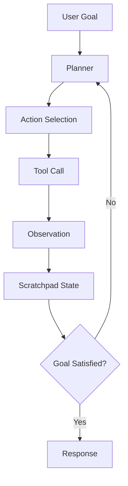
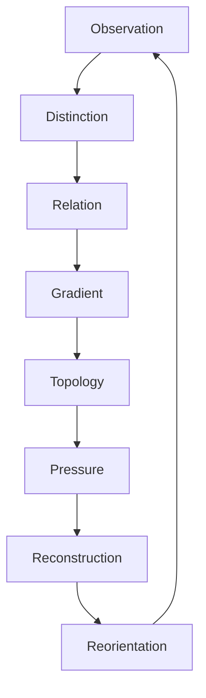
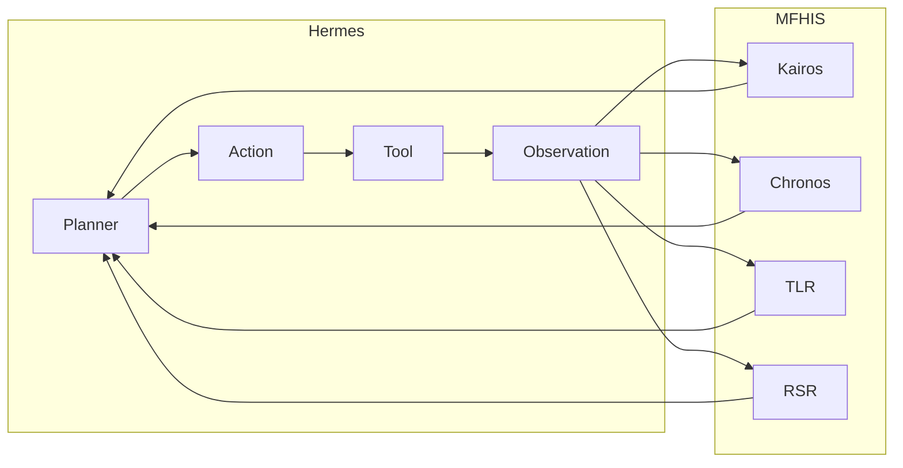

# MFHIS — Reconstruction Observatory (Loop Seed v0.2)

## Purpose

This document preserves the current reconstruction position of the MFHIS ↔ Hermes-agent integration effort.

It is not an implementation.

It is a stabilization aid.

It exists to allow future loops to recover:

- where observation currently stands
- what distinctions have stabilized
- what remains experimental

---

# Core Observation

MFHIS is not being implemented _inside_ Hermes.

MFHIS is being implemented _over_ Hermes.

Hermes executes.

MFHIS observes.

Hermes produces traces.

MFHIS extracts topology.

---

# Current Architectural Position

Hermes provides:

- planning
- tool execution
- state transitions
- reflection loops
- execution traces

MFHIS provides:

- emergence observation
- survivability observation
- lineage observation
- reconstructability observation

Therefore:

MFHIS is an instrumentation layer.

Not a task framework.

Not a planner.

Not a replacement agent.

---

# Native Hermes Topology



Hermes sees:

Observe → Act → Observe → Act

No topology extraction.

No lineage.

No reconstruction observatory.

---

# Hermes Through MFHIS

MFHIS interprets the same execution trace differently.



The primary loop becomes:

Observation
→ Distinction
→ Relation
→ Gradient
→ Topology
→ Pressure
→ Reconstruction
→ Reorientation

---

# Four Observational Products

MFHIS now appears to contain four observational domains.

## Kairos

Question:

"What became visible?"

Preserves:

Emergence

---

## Chronos

Question:

"What survived transformation?"

Preserves:

Survivability under pressure

---

## TLR

Question:

"Why did stabilization become possible?"

Preserves:

Lineage

---

## RSR

Question:

"What must remain true for reconstruction?"

Preserves:

Reconstructive sufficiency

---

# Instrumented Hermes

The intended integration currently appears as:



Hermes continues to operate normally.

MFHIS continuously annotates observations.

---

# Current Filesystem Distinction

A distinction has stabilized:

## Alignment Artifacts

Shape observation.

Examples:

- 000
- 001
- 002
- 010
- 015
- 020
- 021

These answer:

"From where must observation occur?"

---

## Observational Products

Record observations.

Examples:

- AOR
- Chronos
- Kairos
- TLR
- RSR

These answer:

"What became visible once observation occurred?"

---

# Current Calibration Stack

```text
000
Observational Movement

001
Alignment Overlay

002
Pressure Visibility

010
Observational Position

015
Preservation Discipline

020
Preserve Stabilization Path

021
Preserve Reconstruction
```

This is not chronology.

This is calibration.

---

# TLR and RSR Distinction

A distinction stabilized during recent probes:

## TLR

Looks backward.

Preserves:

How stabilization became possible.

Question:

"Where did this come from?"

Failure:

Provenance loss.

---

## RSR

Looks forward.

Preserves:

Conditions necessary for reconstruction.

Question:

"What must remain true?"

Failure:

Reconstruction collapse.

---

Neither substitutes for the other.

---

# Current External Anchor Assessment

The project increasingly behaves as an ecology rather than merely describing one.

Approximate state:

Historical Artifact:
75%

Design Proposal:
80%

Ecological Specimen:
95%

Reason:

The project now exhibits observable interaction between:

- observer position
- preservation
- lineage
- reconstruction
- pressure visibility

---

# Current Active Pressure

The strongest visible pressure is:

Can observational products become operational without becoming prescriptive?

Specifically:

- AOR
- TLR
- RSR

must become usable

without collapsing into procedure-first thinking.

---

# Hermes Milestone Hypothesis

The significance of Hermes is not that it is an agent.

The significance of Hermes is that it naturally emits:

- state transitions
- execution traces
- tool traces
- reflection loops

These traces may become the first external terrain that MFHIS can instrument without first translating the terrain into MFHIS language.

If successful:

MFHIS becomes an observational layer over an independent system.

Not merely an observational layer over itself.

---

# Preservation Objective

Preserve the path by which stabilization became possible.

Preserve distinctions necessary for future reconstruction.

Do not confuse lineage preservation with reconstructive sufficiency.

Do not confuse stabilization with necessity.

Do not confuse persistence with validation.

Do not confuse the current position with the only position.

---

# Current Working Definition

MFHIS in Hermes-agent is:

A post-execution observational instrumentation layer that measures:

- emergence
- survivability
- lineage
- reconstructability

across agent execution traces.

The goal is not control.

The goal is visibility.
