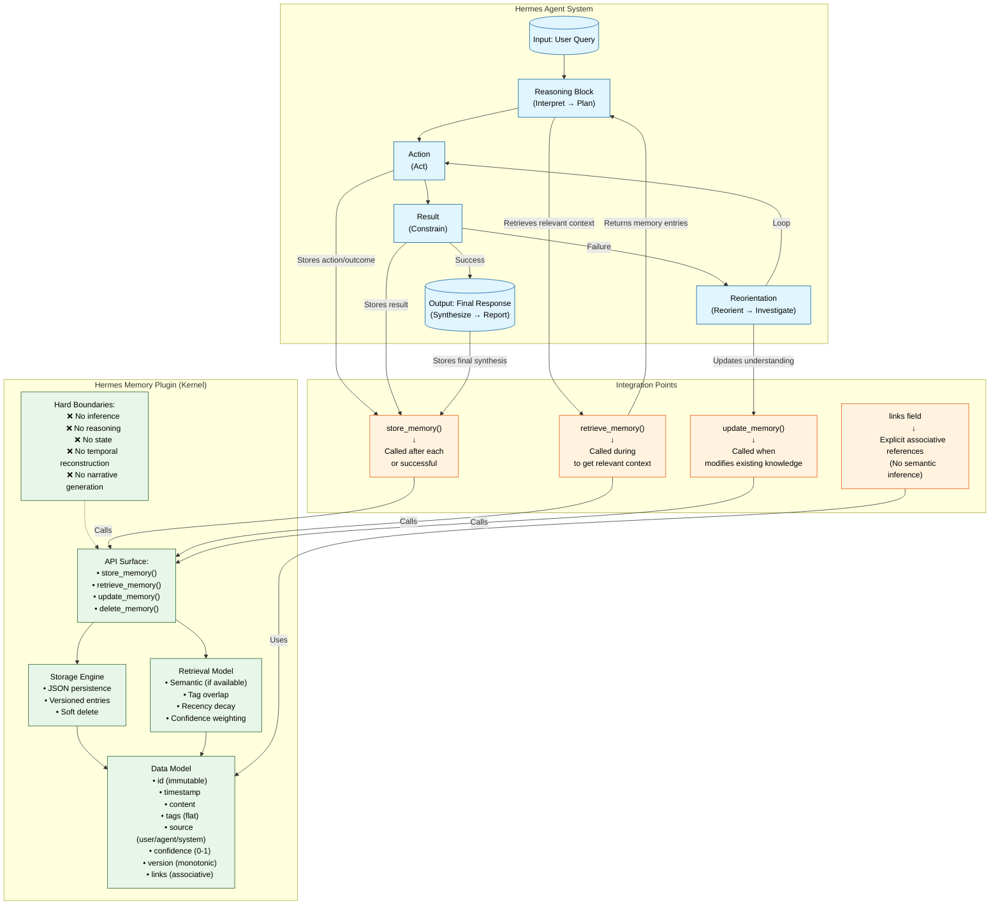

## MERMAID DIAGRAM: Hermes Memory Plugin Integration

---

## DIAGRAM EXPLANATION

### 1. Hermes Agent System (Blue)

The agent's natural cognitive loop:

- **Input** → User query triggers the cycle
- **Think** → Reasoning and planning (Interpret → Plan)
- **Tool Call** → Action execution (Act)
- **Response** → Result from tool (Constrain)
- **Reorient** → Failure handling and investigation (Reorient → Investigate)
- **Output** → Final synthesis and report (Synthesize → Report)

### 2. Memory Plugin (Green)

The minimal kernel system:

- **API Surface**: Four core operations (store, retrieve, update, delete)
- **Storage Engine**: JSON persistence with versioning
- **Retrieval Model**: Multi-signal ranking (semantic + tags + recency + confidence)
- **Data Model**: Canonical memory entry schema
- **Hard Boundaries**: Strict non-inference contract

### 3. Integration Points (Orange)

Where Hermes calls the memory plugin:

- **store_memory()**: Called after each think block or successful tool response
- **retrieve_memory()**: Called during think blocks to get relevant context
- **update_memory()**: Called when tool responses modify existing knowledge
- **links field**: Explicit associative references (no inference)

### Key Separation

The memory plugin is **stateless storage**—it does not:

- Interpret stored memory
- Evaluate truth
- Reconcile contradictions
- Build knowledge graphs
- Infer agent intent

Hermes provides all cognition; the memory plugin provides only persistence and associative retrieval.

---
