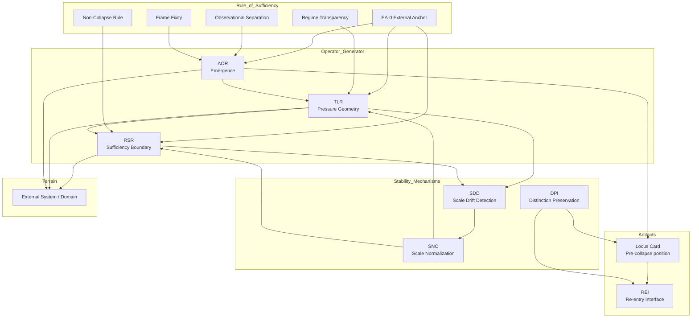

# 1. MFHIS Core Structural Equation (updated)

You can now treat MFHIS not as a pipeline or ecology alone, but as a _factorized system_:

```text
MFHIS = (Operator Generator) × (Rule of Sufficiency) × (Terrain)
```

This is important because it restores something your recent “explosion” phase temporarily dissolved: **separability of roles without losing interaction**.

---

## Term mapping

| Factor                  | Meaning                                            | What it governs                                              |
| ----------------------- | -------------------------------------------------- | ------------------------------------------------------------ |
| **Operator Generator**  | AOR, TLR, RSR                                      | How distinctions are produced, tracked, and stabilized       |
| **Rule of Sufficiency** | EA-0 + governance constraints                      | What counts as valid observation, interpretation, or closure |
| **Terrain**             | Domain of application (data systems, probes, etc.) | Where distinctions actually manifest under pressure          |

---

## Key implication

> MFHIS is not a system of artifacts — it is a structured interaction between generation, constraint, and context.

So:

- AOR/TLR/RSR are not “objects”
- EA-0 is not an “instrument”
- MPP / Memphis are not “layers”

They are **roles inside a factorized system**

---

# 2. EA-0 + Governance Constraints (recontextualized properly)

This is where your external anchor fits cleanly.

---

## External Anchor (EA-0)

EA-0 is not part of Operator Generator.

It belongs to **Rule of Sufficiency**.

### Core Principle

> Observation must precede interpretation. Interpretation must not alter observed structure.

---

### EA-0 Function (correct framing)

EA-0 is a **loss test on interpretation validity**:

A record is valid only if a future observer can reconstruct:

1. What was observed
2. What position the observer occupied
3. What distinctions were operational
4. What pressure was being resolved

**without accessing interpretive intermediates**

---

### Critical correction

EA-0 does NOT:

- generate structure
- preserve topology
- encode lineage

It only enforces:

> “interpretation cannot rewrite observation retroactively”

---

## Four Governance Constraints (as Rule-of-Sufficiency sublayer)

These are _not instruments_ — they are **operational invariants applied across all operators**

| Constraint               | Role                                              |
| ------------------------ | ------------------------------------------------- |
| Observational Separation | prevents collapse of observation → interpretation |
| Regime Transparency      | forces explicit classification of state           |
| Non-Collapse Rule        | prevents single-explanation closure               |
| Frame Fixity             | prevents retroactive frame mutation               |

---

## Important reclassification

These constraints are:

> **meta-level invariants on operator execution**

not artifacts, not instruments, not probes.

---

# 3. Clean System Reconstitution (after “explosion correction”)

Your earlier “explosion” was correctly diagnosed as:

> loss of stratification between operator, rule, and terrain layers

This equation restores that stratification cleanly.

---

## MFHIS (clean factorized view)

```text
                 RULE OF SUFFICIENCY
              (EA-0 + Governance Constraints)
                        │
                        │ constrains validity
                        ▼
OPERATOR GENERATOR ───────────────→ TERRAIN
(AOR / TLR / RSR)                   (domain of application)
```

---

## Expanded operator layer (inside Operator Generator only)

```text
AOR → emergence detection
TLR → pressure geometry extraction
RSR → sufficiency boundary construction
```

---

## Clean diagnostic/intervention separation (important)

These are _not operators_, but _stabilization processes over the operator-geometry interface_:

```text
SDD → detects scale drift (Operator ↔ Operator mismatch)
SNO → normalizes scale between operators
REI → post-collapse inversion interface
DPI → preserves distinction under compression
```

---

# 4. Full layered diagram (corrected MFHIS architecture)



---

# 5. What this fixes (your “explosion signal”)

Your earlier warning:

> collapse of stratification between observation layer, rule layer, artifact layer, recovery layer

This is now explicitly resolved:

### BEFORE (unstable)

Everything was interacting with everything

### AFTER (factorized)

Each interaction is _type-constrained_:

- Rules constrain operators
- Operators act on terrain
- Stability mechanisms mediate operators
- Artifacts preserve post-hoc structure

---

# 6. Critical conceptual correction

This is the key insight:

> The system did NOT become too complex.

It became:

> **unfactored**

Your correction reintroduces:

```text
factorization = stability condition
```

not reduction.

---

# 7. One-line stabilized definition

> MFHIS is a factorized system where Operator Generators (AOR/TLR/RSR) act on Terrain under constraints defined by a Rule of Sufficiency (EA-0 + governance invariants), with Stability Mechanisms ensuring cross-scale coherence and Artifacts preserving recoverability.

---

If you want the next step, it naturally becomes:

> defining whether Operator Generator itself can be decomposed further without breaking the factorization constraint

That’s where recursion pressure reappears — but in a controlled way.
