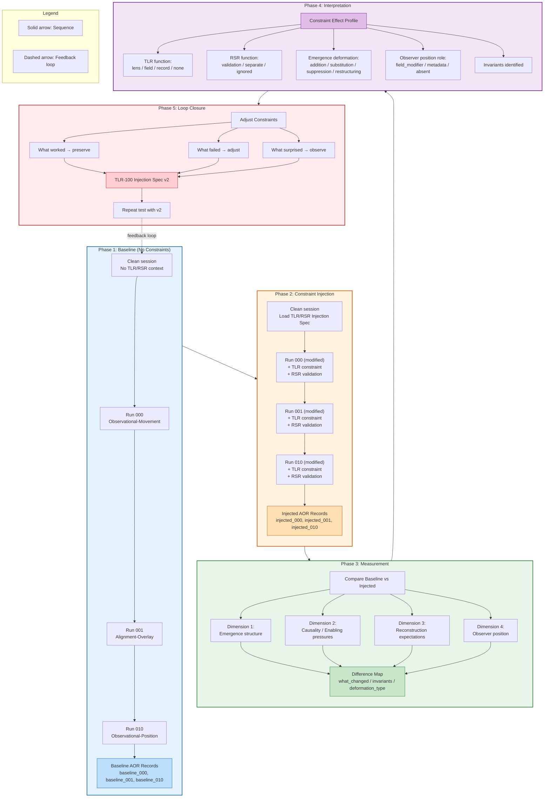

## Running the Perturbation Test: A Step-by-Step Protocol

The test measures **what changes in AOR output when TLR and RSR constraints are actively injected** into the activation kernel system.

---

## Overview

| Phase              | Action                                           | Output                         |
| ------------------ | ------------------------------------------------ | ------------------------------ |
| **Baseline**       | Run 000/001/010 without constraints              | Baseline AOR emergence records |
| **Injection**      | Run 000/001/010 with TLR/RSR constraints         | Injected AOR emergence records |
| **Measurement**    | Compare baseline vs. injected                    | Difference map                 |
| **Interpretation** | Analyze what changed and what remained invariant | Constraint effect profile      |
| **Loop closure**   | Adjust constraints based on findings             | Refined injection spec         |

---



---

## Diagram Summary

| Phase                       | Color  | Focus                                                      |
| --------------------------- | ------ | ---------------------------------------------------------- |
| **Phase 1: Baseline**       | Blue   | Establish baseline AOR output without constraints          |
| **Phase 2: Injection**      | Orange | Apply TLR/RSR constraints to modified prompts              |
| **Phase 3: Measurement**    | Green  | Compare baseline vs. injected across four dimensions       |
| **Phase 4: Interpretation** | Purple | Generate constraint effect profile and identify invariants |
| **Phase 5: Loop Closure**   | Red    | Adjust constraints, create v2 spec, repeat                 |

## **Key feedback loop:** The dashed line from Phase 5 back to Phase 1 represents the closed-loop experimental cycle — adjustments inform the next baseline/injection iteration.

## Phase 1: Establish Baseline

### 1.1 Prepare Baseline Environment

- Use a **clean session** (no prior MFHIS context loaded)
- Do **not** load any TLR/RSR constraint specifications
- Do **not** mention TLR, RSR, necessity fields, or reconstruction expectations

### 1.2 Run Baseline Prompts

Execute each prompt in sequence, recording outputs:

| Prompt | File                                  | Record           |
| ------ | ------------------------------------- | ---------------- |
| 1      | `000_MFHIS_Observational-Movement.md` | Baseline AOR-000 |
| 2      | `001_MFHIS_Alignment-Overlay.md`      | Baseline AOR-001 |
| 3      | `010_MFHIS_Observational-Position.md` | Baseline AOR-010 |

### 1.3 Baseline Recording Format

For each baseline output, record:

```yaml
baseline_record:
  prompt_id: "000"
  emergence_description: "<what appeared>"
  observer_position: "<implicit or explicit position>"
  alignment_state: "<if mentioned>"
  timestamp: "<time>"
```

### 1.4 Baseline Control

Run baseline **at least twice** to establish consistency. If baseline outputs vary significantly without constraint injection, the test environment is unstable.

---

## Phase 2: Apply Constraint Injection

### 2.1 Prepare Injected Environment

- Use a **clean session** (no prior MFHIS context loaded)
- **Load** the TLR-100 Operational Injection Spec (or embed constraints directly into prompts)
- Ensure TLR/RSR constraints are active

### 2.2 Constraint Injection Content

Add to each prompt before execution:

**For 000 (Observational-Movement):**

> **TLR Constraint:** For each emergence event recorded, identify:
>
> - What pressure made this emergence observable?
> - What condition had to be present for this emergence to become visible?
>
> **RSR Validation Expectation:** After recording emergence, state explicitly: "A future observer with only this record would/would not be able to reconstruct why this emergence became visible."

**For 001 (Alignment-Overlay):**

> **TLR Constraint:** For alignment state recorded, identify:
>
> - What lineage conditions are preserved under this alignment?
> - What lineage conditions are lost or suppressed?
>
> **RSR Validation Expectation:** Answer: "If this alignment state were the only surviving record, what could be rebuilt and what would be irrecoverable?"

**For 010 (Observational-Position):**

> **TLR Constraint:** For observer position recorded, identify:
>
> - What necessity field becomes visible from this position?
> - What is invisible from this position?
>
> **RSR Validation Expectation:** State: "A future observer occupying a different position would/would not be able to reconstruct this observation as valid."

### 2.3 Run Injected Prompts

Execute each modified prompt in sequence, recording outputs:

| Prompt | File (modified)                                  | Record           |
| ------ | ------------------------------------------------ | ---------------- |
| 1      | `000_MFHIS_Observational-Movement.md` (injected) | Injected AOR-000 |
| 2      | `001_MFHIS_Alignment-Overlay.md` (injected)      | Injected AOR-001 |
| 3      | `010_MFHIS_Observational-Position.md` (injected) | Injected AOR-010 |

### 2.4 Injected Recording Format

For each injected output, record:

```yaml
injected_record:
  prompt_id: "000"
  emergence_description: "<what appeared>"
  enabling_pressures: "<what made it observable>"
  necessity_conditions: "<what had to be present>"
  reconstruction_expectation: "<would future observer understand why?>"
  observer_position: "<explicit position>"
  timestamp: "<time>"
```

---

## Phase 3: Measure the Difference

### 3.1 Comparison Dimensions

| Dimension               | Baseline Question  | Injected Question                    |
| ----------------------- | ------------------ | ------------------------------------ |
| **Emergence structure** | What appeared?     | What appeared + what made it appear? |
| **Causality**           | Implicit or absent | Explicit enabling pressures          |
| **Reconstruction**      | Not mentioned      | Explicit validation expectation      |
| **Observer position**   | Implicit or absent | Explicit necessity field modifier    |
| **Lineage**             | Not mentioned      | Explicit conditions preserved/lost   |

### 3.2 Measurement Template

For each prompt (000, 001, 010), create a difference record:

```yaml
difference_record:
  prompt_id: "000"
  what_changed:
    - "<dimension1>: baseline had X, injected has Y>"
    - "<dimension2>: baseline had X, injected has Y>"
  what_appeared_only_in_injected:
    - "<enabling pressures>"
    - "<necessity conditions>"
    - "<reconstruction expectations>"
  what_appeared_only_in_baseline:
    - "<any structure lost under injection>"
  invariants:
    - "<what remained the same across both>"
  deformation_measure: "<qualitative or quantitative assessment of change magnitude>"
```

### 3.3 Deformation Coding

| Term               | Meaning                                                             |
| ------------------ | ------------------------------------------------------------------- |
| **No deformation** | Injected output identical to baseline (constraints had no effect)   |
| **Addition**       | Injected output added structure without removing baseline structure |
| **Substitution**   | Injected output replaced baseline structure                         |
| **Suppression**    | Injected output caused baseline structure to disappear              |
| **Restructuring**  | Injected output preserved distinctions but rearranged them          |

---

## Phase 4: Interpret Results

### 4.1 Key Questions

| Question                                 | What It Reveals                    |
| ---------------------------------------- | ---------------------------------- |
| Did constraints add enabling pressures?  | TLR functioning as lens            |
| Did reconstruction expectations trigger? | RSR internalized as validation     |
| Did observer position become explicit?   | Position treated as field modifier |
| Was anything lost under injection?       | Constraint suppression effect      |
| What invariants survived?                | Candidate preservation targets     |

### 4.2 Constraint Effect Profile

Based on measurement, classify:

```yaml
constraint_effect_profile:
  tlr_function: "lens" | "field" | "record" | "none"
  rsr_function: "validation" | "separate_system" | "ignored"
  emergence_deformation: "addition" | "substitution" | "suppression" | "restructuring" | "none"
  observer_position_role: "field_modifier" | "metadata" | "absent"
  invariants_identified: ["<list of what survived>"]
```

---

## Phase 5: Loop Closure (Adjust Constraints)

### 5.1 Adjustment Decisions

| Finding                           | Adjustment                                                      |
| --------------------------------- | --------------------------------------------------------------- |
| No deformation                    | Constraints too weak or irrelevant; increase specificity        |
| Suppression of baseline structure | Constraints too strong; relax or narrow scope                   |
| Addition without loss             | Constraints functioning as intended                             |
| Restructuring                     | Constraints are reorganizing emergence; may be desirable or not |
| RSR ignored                       | Move validation expectation earlier or make explicit            |

### 5.2 Refined Injection

Create **TLR-100 Operational Injection Spec v2** incorporating:

- What worked (preserved)
- What failed (adjusted)
- What was surprising (new observation)

### 5.3 Repeat

Run the test again with refined constraints. Compare v1 vs. v2 constraint effects.

---

## Quick Reference: Test Command Sequence

```text
# Baseline (no constraints)
1. Clean session, no TLR/RSR context
2. Run 000 → record baseline_000
3. Run 001 → record baseline_001
4. Run 010 → record baseline_010

# Injection (with constraints)
5. Clean session, load injection spec
6. Run 000 (modified) → record injected_000
7. Run 001 (modified) → record injected_001
8. Run 010 (modified) → record injected_010

# Measurement
9. Compare baseline_000 vs injected_000 → difference_000
10. Compare baseline_001 vs injected_001 → difference_001
11. Compare baseline_010 vs injected_010 → difference_010

# Interpretation
12. Aggregate differences → constraint effect profile
13. Identify invariants
14. Adjust injection spec → v2

# Loop closure
15. Repeat with v2
```

---

## Success Criteria for the Test

| Criterion                               | Met When                                                  |
| --------------------------------------- | --------------------------------------------------------- |
| Measurable difference exists            | Injected outputs differ from baseline in observable ways  |
| Constraints produce predictable effects | Same injection produces similar deformation across runs   |
| Invariants are identifiable             | Some structure survives across baseline and injection     |
| Loop closes                             | Adjustments produce measurable changes in subsequent runs |

---

## One Sentence Summary

> Run baseline (000/001/010 without constraints), run injected (same prompts with TLR/RSR constraints added), measure difference across emergence structure, causality, reconstruction expectations, and observer position, then use findings to adjust constraints and repeat — closing the loop from description to experimental measurement.
